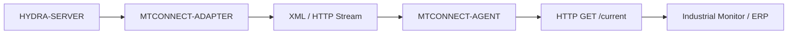

<!-- =============================================================================
HYDRA-UMC-MTCONNECT-ADAPTER - MTConnect probe/current/sample endpoints
Copyright (C) JuanenRac (Electro Hobby 3D) <electrohobby3d@gmail.com>
GPL-3.0-or-later - see LICENSE
============================================================================= -->

<p align="center">
  
</p>

# 🏭 HYDRA-UMC-MTCONNECT-ADAPTER

<p align="center">🇺🇸 <b>English</b> | <a href="README_spa.md">🇪🇸 Español</a> | <a href="README_fra.md">🇫🇷 Français</a> | <a href="README_ita.md">🇮🇹 Italiano</a> | <a href="README_deu.md">🇩🇪 Deutsch</a> | <a href="README_zho.md">🇨🇳 简体中文</a> | <a href="README_jpn.md">🇯🇵 日本語</a> | <a href="README_por.md">🇵🇹 Português</a></p>

### 🛠️ Standardized XML/HTTP Interface for Machine Tool Monitoring

<p align="center">
  
  
  
  
  
  
</p>

---

**Honesty check - what actually runs today:** unit conversion (`src/units.ts`), quality/timestamp/error-code mapping (`src/dataitem.ts`), polling/caching (`src/reader.ts`), the real HYDRA-UMC-SERVER-backed machine reader (`src/hydraServerReader.ts`), and the HTTP server (`src/server.ts`) are all real and tested (131 tests passing across 11 files, including real HTTP requests over a real listening socket via `supertest` - not just a compile check). The device model is hardcoded to exactly one HydraNode (`hydra_umc_1`) - it proves the HTTP surface and XML shape are spec-correct end to end, but a real deployment monitoring more than one robot would need to generate this from HYDRA-UMC-SERVER's own live roster, which doesn't happen yet. The emitted XML has been verified for spec-correct shape (namespaces, `Device`/`DataItem` ids, a shared `instanceId`) but has not yet been tested live against a real third-party MTConnect Agent or collector. See `CHANGELOG.md` for exactly what has shipped so far.

---

> **Safety and security status:** this ecosystem is not a certified safety system. There is no hardware E-STOP path, no firmware-enforced limits or interlocks and no verified motion command yet; firmware images are checked with CRC-32 and an Ed25519 signature, and a release build refuses the published development keys (the tool heads and expansion boards behind the relay still run URTC bootloaders, which take a shared-key HMAC-SHA256 instead of a signature); TLS and mutual TLS are optional and off by default; no custom board has been populated or tested yet. Read the [security baseline](https://github.com/JuanenRac/HYDRA-UMC-DOCS/blob/main/docs/SECURITY_BASELINE.md) and the [threat model](https://github.com/JuanenRac/HYDRA-UMC-DOCS/blob/main/docs/THREAT_MODEL.md) before relying on any statement here for the safety of a person.

---

## 📋 At a glance

| | |
|---|---|
| Version | `0.1.9` |
| Maturity | Functional |
| Tests | 131 (`npm test`) |
| Stack | Node.js / Express / MTConnect 1.7 XML |
| Target | The Raspberry Pi CM5 of a HYDRA-UMC cell |
| On real hardware | Not yet: no run on real hardware is recorded for this version |

**Jump to:** [Overview](#-overview) · [Architecture](#-architecture) · [Configuration](#-configuration) · [Quick start](#-quick-start) · [Testing](#-testing) · [Repository Structure](#-repository-structure) · [Related Projects](#-related-projects)

## 🚦 Project status

Each line is one part of this repository and the light says how far it is today. It is written from what the repository can show (tests, builds, runs), not from what is planned.

🟢 Done and verified · 🟡 Works, with known limits · 🟠 Partly done or not verified yet · 🔴 Not done or not working

| Area | State | What it means here |
|---|---|---|
| Software | 🟡 | Works for its main purpose; the honesty check above lists what is still missing |
| Tests | 🟢 | 131 automated tests, run on every change |
| Real hardware | 🔴 | Not yet: no run on real hardware is recorded for this version |
| Documentation | 🟢 | README in eight languages, checked against the manifest on every change |

## 🎯 Overview

**HYDRA-UMC-MTCONNECT-ADAPTER** is the legacy and factory-standard bridge for machine tool monitoring. It implements the MTConnect protocol (documents of version 1.7, checked against the official XSD), exposing the robotic swarm as a set of standardized machine tools.

It provides a read-only XML/HTTP interface that allows traditional industrial software to monitor the execution state, the availability and the spindle temperature of the HydraNode without needing specialized drivers.

### Key Features:
* 🏭 **Standardized Machine Data:** Exposes a HydraNode as an MTConnect-compliant device. *(currently hardcoded to exactly one HydraNode - `hydra_umc_1` - see `docs/API.md`; proves the HTTP surface and XML shape are spec-correct end to end, a real deployment would generate this from HYDRA-UMC-SERVER's own live robot roster)*
* 📄 **XML Data Streams:** `GET /current`'s real, polled `<Events>`/`<Samples>` blocks in standard XML format. *(implemented)*
* 🌐 **HTTP Interface:** Accessible via simple RESTful queries for easy integration. *(implemented)*
* 🔌 **Real Machine Source:** `HydraServerMachineReader` (`src/hydraServerReader.ts`, `HYDRA_UMC_SERVER_URL`) polls a live HYDRA-UMC-SERVER's own `GET /api/settings` and reports one real robot's own `AVAILABLE`/`ACTIVE`/`INTERRUPTED`/`STOPPED`/`READY` state - not just the `FixtureMachineReader` fallback. See `docs/API.md`. *(implemented)*
* 🔍 **Agent Compatibility:** Verified to emit spec-shaped XML (correct namespaces, consistent `Device`/`DataItem` ids, a shared `instanceId` - see `tests/server.test.ts`) - not yet tested live against a real third-party MTConnect Agent/collector.
* 📐 **Real Unit/Quality Mapping:** Every DataItem's native unit, quality, UTC timestamp and error code are computed by a real, versioned mapping - testable without hardware. *(implemented)*
* 🩹 **Degraded-Mode Output:** A source that's down or reports invalid data renders MTConnect's own real `UNAVAILABLE` value, not a crash or stale data; the document stays valid against the official schema. *(implemented)*
* 🧮 **Observation Buffer:** every change of a DataItem is an observation with its own sequence number, kept in a buffer of `MTCONNECT_BUFFER_SIZE` observations; `GET /sample?from=<nextSequence>&count=<n>` returns exactly what happened since, so a client loop never loses or repeats a change. *(implemented)*
* 🧪 **No invented data:** without `HYDRA_UMC_SERVER_URL` every DataItem is `UNAVAILABLE`; the synthetic demonstration values are served only with `HYDRA_UMC_MTCONNECT_DEMO=1`, and the device says so in its description. *(implemented)*
* 🧩 **Conditions, device routes and HTTP statuses:** a CONDITION DataItem is rendered as Normal, Warning, Fault or Unavailable (with its message and native code) and is declared in `/probe` when the device has one; the device declares `ASSET_CHANGED` and `ASSET_REMOVED` (it has no assets, so they stay UNAVAILABLE); `/HydraNode_1/probe`, `/current` and `/sample` answer for that device; `HYDRA_UMC_MTCONNECT_HTTP_ERRORS=1` makes an MTConnectError carry HTTP 400 or 404 instead of 200 (off by default). All checked against the official XSD. *(implemented)*
* 🔌 **SHDR output for a cppagent:** with `HYDRA_UMC_MTCONNECT_SHDR_PORT` set, the adapter also serves the same observations as SHDR lines (`time|dataItemId|value`, conditions as `time|id|LEVEL|nativeCode|||message`) over TCP, so an off-the-shelf MTConnect agent can read it. A client first receives the latest value of every DataItem, then each change; the only line it may send is `* PING`, answered with `* PONG`. Read only. It listens on `127.0.0.1` unless `HYDRA_UMC_MTCONNECT_SHDR_HOST` says otherwise. Tested against a simulated agent. *(implemented, not yet tried against a real cppagent)*
* 🔌 **Reads the SHDR stream of the CNC bridge (optional):** with `HYDRA_UMC_MTCONNECT_SHDR_SOURCE=host:port` the agent sources the execution and the availability of the machine from the SHDR output of another adapter; a lost connection shows every DataItem as unavailable instead of the last values. Read only.

## 🧩 Role in HYDRA-UMC

**HYDRA-UMC-MTCONNECT-ADAPTER** shows the robots to factory monitoring software as MTConnect devices: read-only XML over HTTP (`/probe`, `/current`, `/sample`), fed from `HYDRA-UMC-SERVER`. It sends no command to any machine.

## 🏛️ Architecture

<p align="center">
  
</p>

<details>
<summary>Text version of the diagram (Mermaid)</summary>



</details>

### ARCHITECTURE & DESIGN DECISIONS

* **Why this is a sibling, not a submodule, of HYDRA-UMC-GATEWAY-INDUSTRIAL.** Each protocol adapter is a separately deployable/restartable process - an MTConnect XML-generation issue never takes down the OPC-UA or MQTT adapters running alongside it.
* **Why a real MTConnect device/agent stream, not a generic XML export.** MTConnect-aware factory software (many CNC/MES tools) expects the specific device/agent/component schema the standard defines - a generic export would need a custom parser on the other end, defeating the point of speaking MTConnect.
* **How this fits the rest of the ecosystem.** A sibling service under HYDRA-UMC-GATEWAY-INDUSTRIAL - translates HYDRA-UMC-SERVER's own state into a real MTConnect device/agent feed.
* **Real HTTP tests, not just a compile check.** `tests/server.test.ts` uses `supertest` (a real HTTP request over a real listening socket) to verify `GET /probe` and `GET /current` return spec-shaped XML with matching namespaces, consistent `Device`/`DataItem` ids between the two documents, and a shared `instanceId`.
* **Why unit conversion, quality classification, and reading a machine are three separate modules.** `src/units.ts` (pure conversion math), `src/dataitem.ts` (quality/timestamp/error-code mapping) and `src/reader.ts` (polling/caching a `MachineReader`) are each testable on their own, without hardware or HTTP - an explicit concern: unit-conversion bugs found through a full HTTP round trip are slow to isolate and easy to miss.
* **Why a degraded DataItem renders MTConnect's real `UNAVAILABLE` value, not a custom error shape.** MTConnect agents and clients already know how to display `UNAVAILABLE` - reusing the spec's own vocabulary means a downstream tool degrades gracefully today. The reason (no data, unit conversion, source down, stale) stays out of the document: the official schema has no attribute for it, and a validating parser rejects a document that carries an extra one.
* **Why `CachedReader`'s polling limit is generic, not hardcoded to `spindle_temp`.** The real risk it guards against - hammering a decades-old controller with requests every time `/current` is hit - applies to `FixtureMachineReader` and the real `HydraServerMachineReader` (`src/hydraServerReader.ts`, polls a live HYDRA-UMC-SERVER's own `GET /api/settings` for real robot state) alike, so the throttle lives at the `MachineReader` interface level, not inside one DataItem's own handling.

## ⚙️ Configuration

The listen port is read from `HYDRA_UMC_MTCONNECT_PORT` first (5000 by default). The shared `PORT` still works as a last resort and prints a warning, so an environment file shared by several services cannot move the agent onto another service's port by accident; a value that is set but is not a valid port stops the start, and the container health check follows the same order.

## 🚀 Quick start

Requires Node.js 20 or newer with npm.

```bash
npm install
npm test
npm run build
npm start
curl http://127.0.0.1:5000/probe
```

## 🧪 Testing

131 automated tests run with `npm test`. They need no hardware and nothing outside this machine.

The CI runs `HYDRA_UMC_CI=1 python tools/ci_validate.py`, which checks the manifest, the documents, the eight READMEs and the pictures.

## 🏗️ Build & Release

### Requirements
- [Node.js](https://nodejs.org/) (v20 or higher recommended)
- npm

### Installation
```bash
npm install
```

### Development Mode
Runs the adapter directly with `tsx` (no bundler):
- **Windows:** double-click `dev.bat` or run `npm run dev`
- **Linux/Mac:** run `./dev.sh` or `npm run dev`

### Production Build
Bundles the adapter into a single deployable file with esbuild:
- **Windows:** double-click `build.bat` or run `npm run build`
- **Linux/Mac:** run `./build.sh` or `npm run build`

Then start it with:
```bash
npm start
```

The adapter listens on `0.0.0.0:5000` - any MTConnect Agent/collector can
query `GET http://<host>:5000/probe` (static device model),
`GET http://<host>:5000/current` (latest DataItem values), and
`GET http://<host>:5000/sample?from=<sequence>` (real, honest streaming
buffer semantics - see `docs/API.md`).

To report a real robot, set `HYDRA_UMC_SERVER_URL`. HYDRA-UMC-SERVER only answers `GET /api/settings` to a logged-in account, so also give the adapter a credential: `HYDRA_UMC_SERVER_TOKEN` (a token the server already issued), or `HYDRA_UMC_SERVER_USER` and `HYDRA_UMC_SERVER_PASSWORD` (the adapter logs in itself, and logs in again when the session expires). Without one the source is reported as unavailable (`SOURCE_UNAVAILABLE`). `HYDRA_UMC_MTCONNECT_HOST` narrows the listen address (default `0.0.0.0`), for example to `127.0.0.1` behind a local reverse proxy. Server responses are read up to 4 MiB.

### Versioning
`npm run build` only bundles the server. The version is raised only by `python tools/hydra_project_tool.py bump` (through `bump_manifest_version.py`).

## 📂 Repository Structure

<p align="center">
  
</p>

<details>
<summary>Text version of the tree</summary>

```text
HYDRA-UMC-MTCONNECT-ADAPTER/
├── src/                       Source code (Node/TypeScript - Adapter, Mapper, HTTP)
├── tests/                     Vitest suite - data-item mapping, units, reader, and server behavior
├── docs/                      documents of the project
├── images/                    Media and diagrams
├── schemas/                   mtconnect-1.7/: the MTConnect 1.7 XSD schemas that the responses are validated against, with their NOTICE
├── scripts/                   Utility scripts (bump-version.mjs)
├── tools/                     build_test.py (non-versioning build check), ci_validate.py (manifest/CHANGELOG/docs validation used by CI), hydra_project_tool.py, and the shared _doc_policy.py and _readme_parity.py
├── .github/                   CI workflow and issue templates
├── CHANGELOG.md               what changed in each version
├── Dockerfile                 container image
├── build-test.sh              non-mutating build check
├── build.sh                   builds and checks; never changes the version
├── bump_manifest_version.py   syncs the manifest version
├── dev.sh                     development mode
├── hydra-umc.project.json     manifest: version, maturity, family
├── package.json               package metadata and scripts
└── test.sh                    runs the tests
```

</details>

## 🗺️ Roadmap & Known limits

**Known limits today**

* **Phase 1:** OPC-UA Pub/Sub implementation for high-speed data exchange and legacy protocol bridging.
* **Phase 2:** MQTT Broker cluster for massive IoT device management and high concurrency.
* **Phase 3:** MTConnect adapter support for multi-vendor CNC and PLC machinery integration.
* **Phase 4:** Support for MTConnect multi-device aggregation and standardized XML/HTTP telemetry streaming.

## 🌍 Languages

This README and the documents of the repository exist in eight languages: English, Spanish, German, French, Italian, Japanese, Chinese and Portuguese (Portugal). They are written together and checked in the CI so that the eight files have the same sections and the same links. This repository has no screen or message catalogue of its own, so there are no interface strings to translate.

## 🔗 Related Projects

This project is part of the HYDRA-UMC robotics ecosystem by the same author (JuanenRac / Electro Hobby 3D). Worth knowing about, since a request might actually be about one of these rather than this repository.

**Parent Project**
- **[HYDRA-UMC-GATEWAY-INDUSTRIAL](https://github.com/JuanenRac/HYDRA-UMC-GATEWAY-INDUSTRIAL)** — integration hub relaying to industrial protocols, with a real command allowlist/backpressure layer; the parent this repo is one specific protocol adapter of, within its own industrial gateway.

**Sibling Projects** — the other protocol adapters of HYDRA-UMC-GATEWAY-INDUSTRIAL's own industrial gateway
- **[HYDRA-UMC-OPCUA-SERVER](https://github.com/JuanenRac/HYDRA-UMC-OPCUA-SERVER)** — real OPC-UA address space, verified with a real binary-protocol client session.
- **[HYDRA-UMC-MQTT-BROKER](https://github.com/JuanenRac/HYDRA-UMC-MQTT-BROKER)** — real MQTT broker with optional per-client authentication and topic ACLs.

**Directly Related**
- **[HYDRA-UMC-SERVER](https://github.com/JuanenRac/HYDRA-UMC-SERVER)** — the real headless backend (REST/WebSocket) every control client actually talks to — the source of the state this adapter exposes.

**Also Part of the Ecosystem**

*Core Hardware & Platform*
- **[HYDRA-UMC](https://github.com/JuanenRac/HYDRA-UMC)** — the robot-arm motherboard design: CM5 host + dual-core STM32H745, meant to orchestrate up to 8 tool arms over CAN-OTA/SPI-OTA (firmware at an early stage; no populated board yet).
- **[HYDRA-UMC-OS](https://github.com/JuanenRac/HYDRA-UMC-OS)** — reproducible Raspberry Pi OS product layer for the CM5: read-only agent, validated config/profiles, WiFi first-contact provisioning.
- **[HYDRA-UMC-SDK](https://github.com/JuanenRac/HYDRA-UMC-SDK)** — the shared JSON-Schema contract and software job-gate boundary every bridge validates its commands against (not a certified safety function).
- **[HYDRA-UMC-CONNECTOR-HUB](https://github.com/JuanenRac/HYDRA-UMC-CONNECTOR-HUB)** — declarative adapter-manifest registry and validator for external-machine connectors; extends the SDK's own contract idea to external machines without replacing the industrial-gateway projects.

*Core Backend & Clients*
- **[HYDRA-UMC-STUDIO](https://github.com/JuanenRac/HYDRA-UMC-STUDIO)** — web control dashboard with real-time multi-robot 3D visualization.
- **[HYDRA-UMC-SUITE](https://github.com/JuanenRac/HYDRA-UMC-SUITE)** — desktop (PySide6) swarm command center for multiple servers at once, packaged as a standalone executable.
- **[HYDRA-UMC-ANDROID-CONTROL](https://github.com/JuanenRac/HYDRA-UMC-ANDROID-CONTROL)** — native Android control app with biometric login and a paired Wear OS companion.
- **[HYDRA-UMC-IOS-CONTROL](https://github.com/JuanenRac/HYDRA-UMC-IOS-CONTROL)** — iOS/iPadOS control app (Flutter) with real-time WebSocket sync.
- **[HYDRA-UMC-DSI](https://github.com/JuanenRac/HYDRA-UMC-DSI)** — native touch UI for the onboard 7" DSI touchscreen, embedded on the CM5 itself.
- **[HYDRA-UMC-EDITOR-URDF](https://github.com/JuanenRac/HYDRA-UMC-EDITOR-URDF)** — desktop graphical URDF creator/editor that pushes finished models into STUDIO's own catalog.
- **[HYDRA-UMC-EDITOR-STL](https://github.com/JuanenRac/HYDRA-UMC-EDITOR-STL)** — desktop STL model editor, transforming/replacing/removing/adding real parts in the same model catalog HYDRA-UMC-EDITOR-URDF also edits.
- **[HYDRA-UMC-BRIDGE-AMR](https://github.com/JuanenRac/HYDRA-UMC-BRIDGE-AMR)** — coordination boundary for AGV/AMR fleets via a VDA 5050 MQTT publisher (tested against an emulated fleet only).
- **[HYDRA-UMC-BRIDGE-CNC](https://github.com/JuanenRac/HYDRA-UMC-BRIDGE-CNC)** — high-level CNC-cell coordinator with GRBL status/control-byte access (tested against an emulator only).
- **[HYDRA-UMC-BRIDGE-DROIDS](https://github.com/JuanenRac/HYDRA-UMC-BRIDGE-DROIDS)** — coordination boundary for legged/humanoid droids, with a Boston Dynamics Spot command sender (tested against an emulator only).
- **[HYDRA-UMC-BRIDGE-LASER](https://github.com/JuanenRac/HYDRA-UMC-BRIDGE-LASER)** — laser-cell coordinator reading 3 key/enclosure/interlock GPIO signals (tested against a fake chip only; it cannot arm or fire a laser).
- **[HYDRA-UMC-BRIDGE-OPENPNP](https://github.com/JuanenRac/HYDRA-UMC-BRIDGE-OPENPNP)** — safe high-level board-flow coordinator for OpenPnP pick-and-place.
- **[HYDRA-UMC-BRIDGE-PRINTER3D](https://github.com/JuanenRac/HYDRA-UMC-BRIDGE-PRINTER3D)** — safe coordination boundary for Moonraker/Klipper 3D printers, with real gated job commands.
- **[HYDRA-UMC-BRIDGE-ROS2](https://github.com/JuanenRac/HYDRA-UMC-BRIDGE-ROS2)** — coordinator with a lazily imported rclpy ROS 2 transport (not yet run against a ROS 2 installation).
- **[HYDRA-UMC-BRIDGE-UAV](https://github.com/JuanenRac/HYDRA-UMC-BRIDGE-UAV)** — coordination boundary for camera-equipped UAVs, with a MAVLink command sender (tested against an emulator only).

*URTC Tool Platform*
- **[URTC](https://github.com/JuanenRac/URTC)** — firmware for the physical Universal Robot Tool Controller PCB, 25+ tool profiles over CAN bus.
- **[URTC-FLASHER](https://github.com/JuanenRac/URTC-FLASHER)** — desktop GUI flashing tool for URTC boards, CAN-OTA plus full-chip SWD/JTAG.
- **[URTC-TESTER](https://github.com/JuanenRac/URTC-TESTER)** — desktop live CAN-bus diagnostic tool for URTC boards, one panel per tool profile.
- **[URTC-WEB-STUDIO](https://github.com/JuanenRac/URTC-WEB-STUDIO)** — browser-based alternative to URTC-TESTER via the Web Serial API, no local install needed.
- **[URTC-GATEWAY](https://github.com/JuanenRac/URTC-GATEWAY)** — gateway in front of the URTC CAN bus: an allowed list of identifiers, a rate limit and a session key; software tested on a computer, not yet on a real bus.

*Vision AI Node (Hailo-8)*
- **[HYDRA-UMC-VISION-NODE](https://github.com/JuanenRac/HYDRA-UMC-VISION-NODE)** — integration hub for the Hailo-8 vision pipeline, with a real per-stage hardware-readiness check.
- **[HYDRA-UMC-DETECTION-HEF](https://github.com/JuanenRac/HYDRA-UMC-DETECTION-HEF)** — real compiled-model registry with Hailo-architecture/checksum safe-load verification.
- **[HYDRA-UMC-VISION-STREAMER](https://github.com/JuanenRac/HYDRA-UMC-VISION-STREAMER)** — real GStreamer pipeline + MediaMTX config generator with a real HailoRT integration boundary.
- **[HYDRA-UMC-VISUAL-SERVOING-API](https://github.com/JuanenRac/HYDRA-UMC-VISUAL-SERVOING-API)** — Position-Based Visual Servoing correction law with authorisation gated on the zone state; no camera pose estimation yet.
- **[HYDRA-UMC-SAFETY-ZONES](https://github.com/JuanenRac/HYDRA-UMC-SAFETY-ZONES)** — v0 zone-breach, calibration-freshness and E-STOP-request logic that takes object positions from a file; no detector feeds it and no physical E-STOP is wired to it yet.

*Cognitive AI Node (Hailo-10)*
- **[HYDRA-UMC-COGNITIVE-NODE](https://github.com/JuanenRac/HYDRA-UMC-COGNITIVE-NODE)** — integration hub for the Hailo-10 cognitive pipeline (LLM/VLA/voice orchestration).
- **[HYDRA-UMC-VLA-ENGINE](https://github.com/JuanenRac/HYDRA-UMC-VLA-ENGINE)** — real action-token encoding/decoding and trajectory generation for a Vision-Language-Action model.
- **[HYDRA-UMC-VOICE-UI](https://github.com/JuanenRac/HYDRA-UMC-VOICE-UI)** — real voice front-end (VAD + intent parser) with a bounded, confirmation-gated Watch relay.
- **[HYDRA-UMC-SEMANTIC-PLANNER](https://github.com/JuanenRac/HYDRA-UMC-SEMANTIC-PLANNER)** — real rule-based task decomposition and semantic error recovery over MCU error codes.
- **[HYDRA-UMC-DOCS-QA](https://github.com/JuanenRac/HYDRA-UMC-DOCS-QA)** — real stdlib-only TF-IDF document search over this ecosystem's own Markdown docs.
- **[HYDRA-UMC-LOCAL-TECHNICIAN](https://github.com/JuanenRac/HYDRA-UMC-LOCAL-TECHNICIAN)** — local, policy-gated AI maintenance technician for the ecosystem itself - observes, diagnoses and proposes fixes; the two highest risk levels are deliberately not implemented yet.

*Orchestration & Swarm*
- **[HYDRA-UMC-ORCHESTRATOR](https://github.com/JuanenRac/HYDRA-UMC-ORCHESTRATOR)** — integration hub with a real gRPC/Protobuf health-report contract and mission state machine.
- **[HYDRA-UMC-JOB-DISPATCHER](https://github.com/JuanenRac/HYDRA-UMC-JOB-DISPATCHER)** — real priority-based job queue with deduplication, over a real HTTP API.
- **[HYDRA-UMC-NODE-HEALING](https://github.com/JuanenRac/HYDRA-UMC-NODE-HEALING)** — real gRPC-based fleet health watchdog with retry/backoff and identity-mismatch detection.
- **[HYDRA-UMC-PATH-PLANNER-3D](https://github.com/JuanenRac/HYDRA-UMC-PATH-PLANNER-3D)** — real RRT-based 3D path planner with real obstacle/workspace collision validation.
- **[HYDRA-UMC-SWARM-SYNC](https://github.com/JuanenRac/HYDRA-UMC-SWARM-SYNC)** — real CRDT LWW-Element-Map state sync, property-tested for multi-cell convergence.

*Digital Twin & Simulation*
- **[HYDRA-UMC-TWIN](https://github.com/JuanenRac/HYDRA-UMC-TWIN)** — integration hub for the digital-twin engine, with a real version-compatibility sync contract.
- **[HYDRA-UMC-HIL-BRIDGE](https://github.com/JuanenRac/HYDRA-UMC-HIL-BRIDGE)** — hardware-in-the-loop router with a software collision interlock between simulation and real hardware (tested without real hardware).
- **[HYDRA-UMC-PHYSICS-REPLICA](https://github.com/JuanenRac/HYDRA-UMC-PHYSICS-REPLICA)** — real forward kinematics and joint-limit validation over a real URDF subset.
- **[HYDRA-UMC-SYNTHETIC-DATA-GEN](https://github.com/JuanenRac/HYDRA-UMC-SYNTHETIC-DATA-GEN)** — real procedural 2D scene generator with YOLO/COCO annotation export.

*Data & Analytics*
- **[HYDRA-UMC-DATALAKE](https://github.com/JuanenRac/HYDRA-UMC-DATALAKE)** — real sqlite3-backed time-series store with a real ingest/query HTTP API.
- **[HYDRA-UMC-ANOMALY-DETECTOR](https://github.com/JuanenRac/HYDRA-UMC-ANOMALY-DETECTOR)** — real FFT + statistical baseline anomaly detector with drift monitoring.
- **[HYDRA-UMC-PRODUCTION-REPORTS](https://github.com/JuanenRac/HYDRA-UMC-PRODUCTION-REPORTS)** — real OEE/availability calculation over DATALAKE history, with reproducible CSV export.
- **[HYDRA-UMC-TELEMETRY-COLLECTOR](https://github.com/JuanenRac/HYDRA-UMC-TELEMETRY-COLLECTOR)** — real CAN/WebSocket ingestion pipeline into DATALAKE, with sequence deduplication.

*Complementary Tools & Ecosystem Operations*
- **[HYDRA-UMC-DASHBOARD-AI](https://github.com/JuanenRac/HYDRA-UMC-DASHBOARD-AI)** — Smart Summaries and Anomaly Highlighting panels over DATALAKE/ANOMALY-DETECTOR, with an honest statistical fallback.
- **[HYDRA-UMC-TOOL-CLI](https://github.com/JuanenRac/HYDRA-UMC-TOOL-CLI)** — fleet CLI with a real, stable exit-code contract, a genuine live client of HYDRA-UMC-SERVER's own API.
- **[HYDRA-UMC-WATCH](https://github.com/JuanenRac/HYDRA-UMC-WATCH)** — WearOS companion app with haptic alert patterns and a paired-phone voice relay (not yet run on a physical watch).
- **[URTC-SMART-RACK](https://github.com/JuanenRac/URTC-SMART-RACK)** — firmware for a board-mounting rack with real tool-ID decoding and Smart Idle pre-heating logic.
- **[URTC-VISION-TOOL](https://github.com/JuanenRac/URTC-VISION-TOOL)** — firmware plus a real Python vision companion for a thermal/RGB inspection tool head.
- **[HYDRA-UMC-UPDATER](https://github.com/JuanenRac/HYDRA-UMC-UPDATER)** — administrative desktop tool that discovers, clones and updates every repo in this ecosystem.
- **[HYDRA-UMC-OS-REBUILDER](https://github.com/JuanenRac/HYDRA-UMC-OS-REBUILDER)** — Windows/Linux desktop tool that builds a ready-to-flash CM5 image pre-loaded with the ecosystem's most current versions, with Raspberry-Pi-Imager-style first-boot Wi-Fi/user/SSH configuration.
- **[HYDRA-UMC-OPS-AGENT](https://github.com/JuanenRac/HYDRA-UMC-OPS-AGENT)** — maintenance-incident coordinator: a low-privilege edge role collects a sanitized inventory/health snapshot, a control-plane role renders it read-only and asks an AI provider to suggest a diagnosis - never applies a patch or deploys anything.
- **[HYDRA-UMC-DEV-SERVER](https://github.com/JuanenRac/HYDRA-UMC-DEV-SERVER)** — reproducible development host (Raspberry Pi 5 / CM5) that stores the ecosystem's source and runs bounded build/test tasks under a durable queue; a dedicated dev role, explicitly not an operational CM5.

## 📚 Documentation

Where to read more:

* **[docs/API.md](docs/API.md)** — the real HTTP endpoint reference: `GET /probe`/`GET /current`/`GET /sample` request/response shape, full example XML envelopes, the two real `MachineReader` implementations (`FixtureMachineReader`/`HydraServerMachineReader`), and an explicit callout of what's still a placeholder (the single hardcoded HydraNode - the dynamic, one-Device-per-robot tree is separate, larger work).
* [Security baseline of the ecosystem](https://github.com/JuanenRac/HYDRA-UMC-DOCS/blob/main/docs/SECURITY_BASELINE.md)
* [Threat model of the ecosystem](https://github.com/JuanenRac/HYDRA-UMC-DOCS/blob/main/docs/THREAT_MODEL.md)
* [Changelog of this repository](CHANGELOG.md)
* [License of this repository](LICENSE.md)

## 🤝 Contributing & Community

* Before a pull request run `HYDRA_UMC_CI=1 py -3 tools/ci_validate.py` (or `HYDRA_UMC_CI=1 python3 tools/ci_validate.py`): it must print `CI_VALIDATION=PASS`. Do not run `build.sh` or `build.bat` for this check; building is not a check.
* The eight READMEs are written from one source in HYDRA-UMC-DOCS; do not edit them by hand. Change the source and write them again with `tools/make_readmes.py`.
* Do not state in a README what has not run: say "simulated" or "not tried on hardware" where that is the truth.
* See [CONTRIBUTING.md](CONTRIBUTING.md), the [code of conduct](CODE_OF_CONDUCT.md), [SECURITY.md](SECURITY.md) and [SUPPORT.md](SUPPORT.md).

## 👤 AUTHOR

**JuanenRac (Electro Hobby 3D)** · electrohobby3d@gmail.com

## 📜 LICENSE

GPL-3.0-or-later - [LICENSE](LICENSE).
