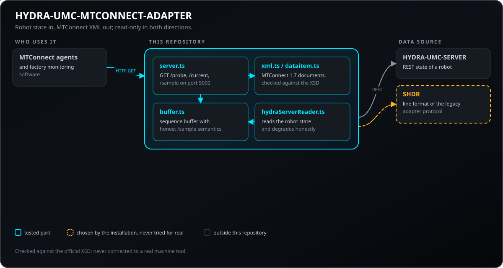
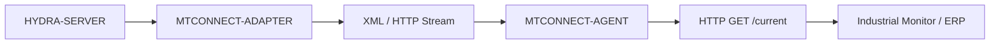
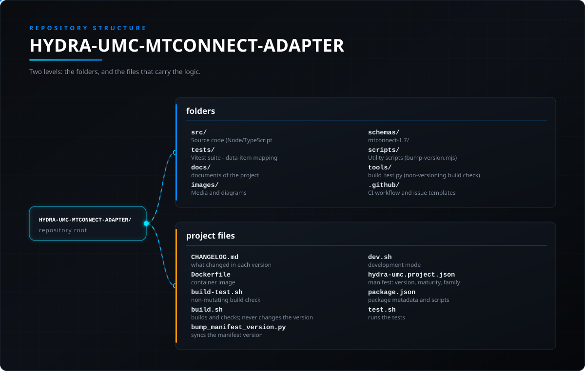

<!-- =============================================================================
HYDRA-UMC-MTCONNECT-ADAPTER - MTConnect probe/current/sample endpoints
Copyright (C) JuanenRac (Electro Hobby 3D) <electrohobby3d@gmail.com>
GPL-3.0-or-later - see LICENSE
============================================================================= -->

<p align="center">
  
</p>

# 🏭 HYDRA-UMC-MTCONNECT-ADAPTER

<p align="center"><a href="README.md">🇺🇸 English</a> | <a href="README_spa.md">🇪🇸 Español</a> | <a href="README_fra.md">🇫🇷 Français</a> | 🇮🇹 <b>Italiano</b> | <a href="README_deu.md">🇩🇪 Deutsch</a> | <a href="README_zho.md">🇨🇳 简体中文</a> | <a href="README_jpn.md">🇯🇵 日本語</a> | <a href="README_por.md">🇵🇹 Português</a></p>

### 🛠️ Interfaccia XML/HTTP standardizzata per il monitoraggio delle macchine utensili

<p align="center">
  
  
  
  
  
  
</p>

---

**Controllo di onestà - cosa funziona davvero oggi:** la conversione di unità (`src/units.ts`), la mappatura qualità/timestamp/codice errore (`src/dataitem.ts`), il polling/caching (`src/reader.ts`), il vero lettore di macchina basato su HYDRA-UMC-SERVER (`src/hydraServerReader.ts`), e il server HTTP (`src/server.ts`) sono tutti reali e testati (136 test superati in 13 file, incluse vere richieste HTTP su un vero socket in ascolto tramite `supertest` - non solo un controllo di compilazione). Il modello del dispositivo è fisso a esattamente un HydraNode (`hydra_umc_1`) - dimostra che la superficie HTTP e la forma XML sono corrette secondo lo spec end-to-end, ma un vero deployment che monitori più di un robot dovrebbe generare questo a partire dal reale elenco live di HYDRA-UMC-SERVER, cosa che non avviene ancora. L'XML emesso è stato verificato per una forma corretta secondo lo spec (namespace, id `Device`/`DataItem`, un `instanceId` condiviso) ma non è ancora stato testato dal vivo contro un vero Agent/collector MTConnect di terze parti. Vedi `CHANGELOG.md` per ciò che è stato consegnato esattamente finora.

---

> **Stato di sicurezza (safety e security):** questo ecosistema non è un sistema di sicurezza certificato. Non esiste ancora un percorso E-STOP hardware, né limiti o interblocchi imposti dal firmware, né un comando di movimento verificato; le immagini firmware sono controllate con CRC-32 e una firma Ed25519, e una compilazione di rilascio rifiuta le chiavi di sviluppo pubblicate (le teste utensile e le schede di espansione dietro il relè usano ancora i bootloader di URTC, che accettano un HMAC-SHA256 a chiave condivisa invece di una firma); TLS e TLS reciproco sono opzionali e disattivati per impostazione predefinita; nessuna scheda propria è stata ancora assemblata o provata. Leggi la [base di sicurezza](https://github.com/JuanenRac/HYDRA-UMC-DOCS/blob/main/docs/SECURITY_BASELINE.md) e il [modello delle minacce](https://github.com/JuanenRac/HYDRA-UMC-DOCS/blob/main/docs/THREAT_MODEL.md) prima di fidarti di qualsiasi affermazione qui per la sicurezza di una persona.

---

## 📋 In breve

| | |
|---|---|
| Versione | `0.2.0` |
| Maturità | Funzionale |
| Test | 136 (`npm test`) |
| Tecnologia | Node.js / Express / MTConnect 1.7 XML |
| Destinazione | Il Raspberry Pi CM5 di una cella HYDRA-UMC |
| Su hardware reale | Non ancora: per questa versione non risulta alcuna esecuzione su hardware reale |

**Vai a:** [Panoramica](#-panoramica) · [Architettura](#-architettura) · [Configurazione](#-configurazione) · [Avvio rapido](#-avvio-rapido) · [Test](#-test) · [Struttura del repository](#-struttura-del-repository) · [Progetti correlati](#-progetti-correlati)

## 🚦 Stato del progetto

Ogni riga è una parte di questo repository e il semaforo dice a che punto è oggi. È scritta in base a ciò che il repository può mostrare (test, compilazioni, esecuzioni), non a ciò che è previsto.

🟢 Fatto e verificato · 🟡 Funziona, con limiti noti · 🟠 Fatto a metà o non ancora verificato · 🔴 Non fatto o non funzionante

| Area | Stato | Cosa significa qui |
|---|---|---|
| Software | 🟡 | Funziona per il suo scopo principale; la verifica di onestà qui sopra elenca ciò che manca ancora |
| Test | 🟢 | 136 test automatici, eseguiti a ogni modifica |
| Hardware reale | 🔴 | Non ancora: per questa versione non risulta alcuna esecuzione su hardware reale |
| Documentazione | 🟢 | README in otto lingue, verificato rispetto al manifesto a ogni modifica |

## 🎯 Panoramica

**HYDRA-UMC-MTCONNECT-ADAPTER** è il bridge standard di fabbrica e legacy per il monitoraggio delle macchine utensili. Implementa il protocollo MTConnect (documenti della versione 1.7, verificati con l'XSD ufficiale), esponendo lo sciame robotico come un set di macchine utensili standardizzate.

Fornisce un'interfaccia XML/HTTP di sola lettura che consente ai software industriali tradizionali di monitorare lo stato di esecuzione, la disponibilità e la temperatura del mandrino dell'HydraNode senza la necessità di driver specializzati.

### Caratteristiche principali:
* 🏭 **Dati macchina standardizzati:** Espone un HydraNode come dispositivo conforme a MTConnect. *(oggi fissato a esattamente un HydraNode - `hydra_umc_1` - vedi `docs/API.md`; dimostra che la superficie HTTP e la forma XML sono corrette secondo la specifica end-to-end, un deployment reale genererebbe questo dal proprio elenco di robot dal vivo di HYDRA-UMC-SERVER)*
* 📄 **Flussi di dati XML:** I blocchi `<Events>`/`<Samples>` reali e interrogati di `GET /current` in formato XML standard. *(implementato)*
* 🔌 **Fonte macchina reale:** `HydraServerMachineReader` (`src/hydraServerReader.ts`, `HYDRA_UMC_SERVER_URL`) interroga un vero HYDRA-UMC-SERVER live tramite il proprio `GET /api/settings` e riporta lo stato reale (`AVAILABLE`/`ACTIVE`/`INTERRUPTED`/`STOPPED`/`READY`) di un robot reale - non solo il fallback `FixtureMachineReader`. Vedi `docs/API.md`. *(implementato)*
* 🌐 **Interfaccia HTTP:** Accessibile tramite semplici query RESTful per una facile integrazione. *(implementato)*
* 🔍 **Compatibilità con gli agenti:** Verificato che emette XML nella forma corretta secondo la specifica (namespace corretti, id `Device`/`DataItem` coerenti, un `instanceId` condiviso - vedi `tests/server.test.ts`) - non ancora testato dal vivo contro un vero Agent/collettore MTConnect di terze parti.
* 📐 **Mappatura reale unità/qualità:** L'unità nativa, la qualità, il timestamp UTC e il codice di errore di ogni DataItem sono calcolati da una mappatura reale e versionata - testabile senza hardware. *(implementato)*
* 🩹 **Output in modalità degradata:** Una fonte non disponibile o che segnala dati non validi viene resa con il vero valore `UNAVAILABLE` di MTConnect, non come un arresto anomalo né come dati obsoleti; il documento resta valido secondo lo schema ufficiale. *(implementato)*
* 🧮 **Buffer di osservazioni:** ogni cambiamento di un DataItem è un'osservazione con il proprio numero di sequenza, conservata in un buffer di `MTCONNECT_BUFFER_SIZE` osservazioni; `GET /sample?from=<nextSequence>&count=<n>` restituisce esattamente ciò che è successo da allora, così un ciclo client non perde né ripete mai un cambiamento. *(implementato)*
* 🧪 **Nessun dato inventato:** senza `HYDRA_UMC_SERVER_URL` ogni DataItem è `UNAVAILABLE`; i valori sintetici di dimostrazione vengono serviti solo con `HYDRA_UMC_MTCONNECT_DEMO=1`, e il dispositivo lo dichiara nella sua descrizione. *(implementato)*
* 🧩 **Condizioni, rotte per dispositivo e stati HTTP:** un DataItem CONDITION viene reso come Normal, Warning, Fault o Unavailable (con il suo messaggio e il codice nativo) e dichiarato in `/probe` quando il dispositivo ne ha uno; il dispositivo dichiara `ASSET_CHANGED` e `ASSET_REMOVED` (non ha asset, quindi restano UNAVAILABLE); `/HydraNode_1/probe`, `/current` e `/sample` rispondono per quel dispositivo; `HYDRA_UMC_MTCONNECT_HTTP_ERRORS=1` fa portare a un MTConnectError lo stato HTTP 400 o 404 invece di 200 (disattivato per impostazione predefinita). Tutto verificato con l'XSD ufficiale. *(implementato)*
* 🔌 **Uscita SHDR per un cppagent:** con `HYDRA_UMC_MTCONNECT_SHDR_PORT` impostato, l'adattatore serve anche le stesse osservazioni come righe SHDR (`ora|dataItemId|valore`, condizioni come `ora|id|LIVELLO|codiceNativo|||messaggio`) via TCP, così un agente MTConnect standard può leggerlo. Un client riceve prima l'ultimo valore di ogni DataItem, poi ogni cambiamento; l'unica riga che può inviare è `* PING`, a cui si risponde con `* PONG`. Sola lettura. Ascolta su `127.0.0.1` salvo diversa indicazione di `HYDRA_UMC_MTCONNECT_SHDR_HOST`. Provato con un agente simulato. *(implementato, non ancora provato con un cppagent reale)*
* 🔌 **Legge il flusso SHDR del bridge CNC (facoltativo):** con `HYDRA_UMC_MTCONNECT_SHDR_SOURCE=host:porta` l'agente ricava l'esecuzione e la disponibilità della macchina dall'uscita SHDR di un altro adattatore; una connessione persa mostra tutti i DataItem come non disponibili invece degli ultimi valori. Sola lettura.

## 🧩 Ruolo in HYDRA-UMC

**HYDRA-UMC-MTCONNECT-ADAPTER** mostra i robot al software di monitoraggio di fabbrica come dispositivi MTConnect: XML in sola lettura su HTTP (`/probe`, `/current`, `/sample`), alimentato da `HYDRA-UMC-SERVER`. Non invia alcun comando ad alcuna macchina.

## 🏛️ Architettura

<p align="center">
  
</p>

<details>
<summary>Versione testuale del diagramma (Mermaid)</summary>



</details>

### ARCHITETTURA E DECISIONI DI PROGETTAZIONE

* **Perché è fratello, non un sottomodulo, di HYDRA-UMC-GATEWAY-INDUSTRIAL.** Ogni adattatore di protocollo è un processo distribuibile/riavviabile separatamente - un problema nella generazione XML MTConnect non abbatte mai gli adattatori OPC-UA o MQTT che girano accanto.
* **Perché un vero flusso device/agent MTConnect, non un export XML generico.** Il software di fabbrica compatibile MTConnect (molti strumenti CNC/MES) si aspetta lo schema specifico device/agent/component definito dallo standard - un export generico richiederebbe un parser su misura dall'altra parte, vanificando il senso di parlare MTConnect.
* **Come si inserisce nel resto dell'ecosistema.** Un servizio fratello sotto HYDRA-UMC-GATEWAY-INDUSTRIAL - traduce lo stato proprio di HYDRA-UMC-SERVER in un vero flusso device/agent MTConnect.
* **Test HTTP reali, non solo un controllo di compilazione.** `tests/server.test.ts` usa `supertest` (una richiesta HTTP reale su un socket reale in ascolto) per verificare che `GET /probe` e `GET /current` restituiscano XML nella forma corretta dello spec, con namespace corrispondenti, id `Device`/`DataItem` coerenti tra i due documenti, e un `instanceId` condiviso.
* **Perché la conversione di unità, la classificazione della qualità e la lettura di una macchina sono tre moduli separati.** `src/units.ts` (matematica di conversione pura), `src/dataitem.ts` (mappatura qualità/timestamp/codice di errore) e `src/reader.ts` (polling/caching di un `MachineReader`) sono ciascuno testabile separatamente, senza hardware né HTTP - una preoccupazione esplicita: i bug di conversione delle unità trovati tramite un round trip HTTP completo sono lenti da isolare e facili da perdere.
* **Perché un DataItem degradato rende il vero valore `UNAVAILABLE` di MTConnect e non una forma di errore personalizzata.** Gli agenti e i client MTConnect sanno già mostrare `UNAVAILABLE`: riusare il vocabolario della specifica stessa significa che uno strumento a valle si degrada con eleganza già oggi. Il motivo (nessun dato, conversione di unità, fonte non disponibile, obsoleto) resta fuori dal documento: lo schema ufficiale non ha un attributo per questo e un parser validante rifiuta un documento che ne porta uno in più.
* **Perché il limite di polling di `CachedReader` è generico, non hardcoded su `spindle_temp`.** Nessuna fonte macchina reale esiste ancora in questo ambiente, ma il rischio reale da cui si protegge - martellare di richieste un controller vecchio di decenni ogni volta che viene chiamato `/current` - si applica a qualunque fonte sostituirà eventualmente `FixtureMachineReader`, quindi il limite vive a livello dell'interfaccia `MachineReader`, non dentro la gestione propria di un singolo DataItem.

## ⚙️ Configurazione

La porta di ascolto viene letta prima da `HYDRA_UMC_MTCONNECT_PORT` (5000 per impostazione predefinita). Il `PORT` condiviso vale ancora come ultima risorsa e stampa un avviso, così che un file di ambiente condiviso da più servizi non possa spostare l'agente sulla porta di un altro servizio per errore; un valore impostato ma non valido come porta ferma l'avvio, e il controllo di salute del container segue lo stesso ordine.

## 🚀 Avvio rapido

Richiede Node.js 20 o successivo con npm.

```bash
npm install
npm test
npm run build
npm start
curl http://127.0.0.1:5000/probe
```

## 🧪 Test

136 test automatici si eseguono con `npm test`. Non richiedono hardware né nulla al di fuori di questa macchina.

La CI esegue `HYDRA_UMC_CI=1 python tools/ci_validate.py`, che controlla il manifesto, i documenti, gli otto README e le immagini.

## 🏗️ Compilazione e rilascio

### Requisiti
- [Node.js](https://nodejs.org/) (v20 o superiore consigliato)
- npm

### Installazione
```bash
npm install
```

### Modalità Sviluppo
Esegue l'adattatore direttamente con `tsx` (senza bundler):
- **Windows:** doppio clic su `dev.bat` oppure eseguire `npm run dev`
- **Linux/Mac:** eseguire `./dev.sh` oppure `npm run dev`

### Build di Produzione
Impacchetta l'adattatore in un unico file distribuibile con esbuild:
- **Windows:** doppio clic su `build.bat` oppure eseguire `npm run build`
- **Linux/Mac:** eseguire `./build.sh` oppure `npm run build`

Poi avvialo con:
```bash
npm start
```

L'adattatore resta in ascolto su `0.0.0.0:5000` - qualsiasi
Agente/collettore MTConnect può interrogare
`GET http://<host>:5000/probe` (modello statico del dispositivo),
`GET http://<host>:5000/current` (ultimi valori dei DataItem) e
`GET http://<host>:5000/sample?from=<sequence>` (semantica reale e
onesta del buffer di streaming - vedi `docs/API.md`).

Per riportare un robot reale, imposti `HYDRA_UMC_SERVER_URL`. HYDRA-UMC-SERVER risponde a `GET /api/settings` solo a un account con accesso effettuato, quindi dia all'adattatore anche una credenziale: `HYDRA_UMC_SERVER_TOKEN` (un token già emesso dal server), oppure `HYDRA_UMC_SERVER_USER` e `HYDRA_UMC_SERVER_PASSWORD` (l'adattatore esegue il login da solo e lo ripete quando la sessione scade). Senza nessuna, la sorgente è segnalata come non disponibile (`SOURCE_UNAVAILABLE`). `HYDRA_UMC_MTCONNECT_HOST` restringe l'indirizzo di ascolto (predefinito `0.0.0.0`), ad esempio a `127.0.0.1` dietro un reverse proxy locale. Le risposte del server vengono lette fino a 4 MiB.

### Versionamento
`npm run build` si limita a impacchettare il server. La versione viene alzata solo da `python tools/hydra_project_tool.py bump` (tramite `bump_manifest_version.py`), un "contachilometri" in base 10: patch +1 per bump, con riporto su minor (e da minor a major) dopo 9 invece di raggiungere un segmento a due cifre (`0.0.9` -> `0.1.0`, non `0.0.10`).

## 📂 Struttura del repository

<p align="center">
  
</p>

<details>
<summary>Versione testuale dell'albero</summary>

```text
HYDRA-UMC-MTCONNECT-ADAPTER/
├── src/                       Codice sorgente (Node/TypeScript - Adattatore, Mapper, HTTP)
├── tests/                     Suite Vitest - mapping dei data item, unità, comportamento di reader e server
├── docs/                      documenti del progetto
├── images/                    Media e diagrammi
├── schemas/                   mtconnect-1.7/: gli schemi XSD di MTConnect 1.7 rispetto ai quali si validano le risposte, con la loro NOTICE
├── scripts/                   Script di utilità (bump-version.mjs)
├── tools/                     build_test.py (controllo di build senza versionamento), ci_validate.py (validazione manifest/CHANGELOG/docs usata dalla CI), hydra_project_tool.py e i condivisi _doc_policy.py e _readme_parity.py
├── .github/                   workflow di CI e modelli di segnalazione
├── CHANGELOG.md               cosa è cambiato in ogni versione
├── Dockerfile                 immagine del container
├── build-test.sh              controllo di build senza modifiche
├── build.sh                   compila e controlla; non cambia mai la versione
├── bump_manifest_version.py   sincronizza la versione del manifesto
├── dev.sh                     modalità di sviluppo
├── hydra-umc.project.json     manifesto: versione, maturità, famiglia
├── package.json               metadati e script del pacchetto
└── test.sh                    esegue i test
```

</details>

## 🗺️ Roadmap e limiti noti

**Limiti noti oggi**

* **Fase 1:** Implementazione di OPC-UA Pub/Sub per lo scambio di dati ad alta velocità e bridging di protocolli legacy.
* **Fase 2:** Cluster MQTT Broker per la gestione massiva di dispositivi IoT e alta concorrenza.
* **Fase 3:** Supporto per l'adattatore MTConnect per l'integrazione di macchinari CNC e PLC multi-vendor.
* **Fase 4:** Supporto per l'aggregazione multi-dispositivo MTConnect e streaming di telemetria XML/HTTP standardizzato.

## 🌍 Lingue

Questo README e i documenti del repository esistono in otto lingue: inglese, spagnolo, tedesco, francese, italiano, giapponese, cinese e portoghese (Portogallo). Sono scritti insieme e la CI verifica che gli otto file abbiano le stesse sezioni e gli stessi link. Questo repository non ha uno schermo né un catalogo di messaggi propri, quindi non ci sono stringhe di interfaccia da tradurre.

## 🔗 Progetti correlati

Questo progetto fa parte dell'ecosistema robotico HYDRA-UMC dello stesso autore (JuanenRac / Electro Hobby 3D). Vale la pena conoscerlo, poiché una richiesta potrebbe in realtà riguardare uno di questi invece di questo repository.

**Progetto Padre**
- **[HYDRA-UMC-GATEWAY-INDUSTRIAL](https://github.com/JuanenRac/HYDRA-UMC-GATEWAY-INDUSTRIAL)** — hub di integrazione che inoltra ai protocolli industriali, con un vero livello di allowlist dei comandi/backpressure; il genitore di cui questo repository è un adattatore di protocollo specifico, all'interno del proprio gateway industriale.

**Progetti Fratelli** — gli altri adattatori di protocollo del gateway industriale proprio di HYDRA-UMC-GATEWAY-INDUSTRIAL
- **[HYDRA-UMC-OPCUA-SERVER](https://github.com/JuanenRac/HYDRA-UMC-OPCUA-SERVER)** — vero spazio di indirizzi OPC-UA, verificato con una vera sessione client del protocollo binario.
- **[HYDRA-UMC-MQTT-BROKER](https://github.com/JuanenRac/HYDRA-UMC-MQTT-BROKER)** — vero broker MQTT con autenticazione opzionale per client e ACL sui topic.

**Direttamente Correlati**
- **[HYDRA-UMC-SERVER](https://github.com/JuanenRac/HYDRA-UMC-SERVER)** — il vero backend headless (REST/WebSocket) con cui parla davvero ogni client di controllo — la fonte dello stato che questo adattatore espone.

**Fa Anche Parte dell'Ecosistema**

*Hardware e Piattaforma di Base*
- **[HYDRA-UMC](https://github.com/JuanenRac/HYDRA-UMC)** — il progetto della scheda madre del braccio robotico: host CM5 + coprocessore STM32H745 dual-core, pensato per coordinare fino a 8 bracci utensile via CAN-OTA/SPI-OTA (firmware in fase iniziale; nessuna scheda assemblata per ora).
- **[HYDRA-UMC-OS](https://github.com/JuanenRac/HYDRA-UMC-OS)** — livello prodotto riproducibile su Raspberry Pi OS per il CM5: agente in sola lettura, config/profili validati, provisioning WiFi al primo contatto.
- **[HYDRA-UMC-SDK](https://github.com/JuanenRac/HYDRA-UMC-SDK)** — il contratto JSON-Schema condiviso e la barriera software di controllo dei job contro cui ogni bridge valida i propri comandi (non è una funzione di sicurezza certificata).
- **[HYDRA-UMC-CONNECTOR-HUB](https://github.com/JuanenRac/HYDRA-UMC-CONNECTOR-HUB)** — registro dichiarativo e validatore di manifesti adattatore per connettori di macchine esterne; estende la propria idea di contratto dell'SDK alle macchine esterne senza sostituire i progetti di gateway industriale.

*Backend Centrale e Client*
- **[HYDRA-UMC-STUDIO](https://github.com/JuanenRac/HYDRA-UMC-STUDIO)** — dashboard di controllo web con visualizzazione 3D multi-robot in tempo reale.
- **[HYDRA-UMC-SUITE](https://github.com/JuanenRac/HYDRA-UMC-SUITE)** — centro di comando sciame desktop (PySide6) per più server contemporaneamente, pacchettizzato come eseguibile standalone.
- **[HYDRA-UMC-ANDROID-CONTROL](https://github.com/JuanenRac/HYDRA-UMC-ANDROID-CONTROL)** — app di controllo nativa per Android con login biometrico e un companion Wear OS abbinato.
- **[HYDRA-UMC-IOS-CONTROL](https://github.com/JuanenRac/HYDRA-UMC-IOS-CONTROL)** — app di controllo per iOS/iPadOS (Flutter) con sincronizzazione WebSocket in tempo reale.
- **[HYDRA-UMC-DSI](https://github.com/JuanenRac/HYDRA-UMC-DSI)** — interfaccia touch nativa per il touchscreen DSI da 7" a bordo, incorporata direttamente nel CM5.
- **[HYDRA-UMC-EDITOR-URDF](https://github.com/JuanenRac/HYDRA-UMC-EDITOR-URDF)** — creatore/editor grafico desktop di URDF che invia i modelli finiti al catalogo di STUDIO.
- **[HYDRA-UMC-EDITOR-STL](https://github.com/JuanenRac/HYDRA-UMC-EDITOR-STL)** — editor desktop di modelli STL, che trasforma/sostituisce/rimuove/aggiunge veri pezzi nello stesso catalogo di modelli modificato anche da HYDRA-UMC-EDITOR-URDF.
- **[HYDRA-UMC-BRIDGE-AMR](https://github.com/JuanenRac/HYDRA-UMC-BRIDGE-AMR)** — barriera di coordinamento per flotte AGV/AMR tramite un publisher MQTT VDA 5050 (testato solo contro una flotta emulata).
- **[HYDRA-UMC-BRIDGE-CNC](https://github.com/JuanenRac/HYDRA-UMC-BRIDGE-CNC)** — coordinatore ad alto livello per celle CNC con accesso a stato/byte di controllo GRBL (testato solo contro un emulatore).
- **[HYDRA-UMC-BRIDGE-DROIDS](https://github.com/JuanenRac/HYDRA-UMC-BRIDGE-DROIDS)** — barriera di coordinamento per droidi con zampe/umanoidi, con un mittente di comandi per Boston Dynamics Spot (testato solo contro un emulatore).
- **[HYDRA-UMC-BRIDGE-LASER](https://github.com/JuanenRac/HYDRA-UMC-BRIDGE-LASER)** — coordinatore per celle laser che legge 3 segnali GPIO di chiave/involucro/interblocco (testato solo contro un chip simulato; non può armare né far partire un laser).
- **[HYDRA-UMC-BRIDGE-OPENPNP](https://github.com/JuanenRac/HYDRA-UMC-BRIDGE-OPENPNP)** — coordinatore ad alto livello sicuro per il flusso schede del pick-and-place OpenPnP.
- **[HYDRA-UMC-BRIDGE-PRINTER3D](https://github.com/JuanenRac/HYDRA-UMC-BRIDGE-PRINTER3D)** — barriera di coordinamento sicura per stampanti 3D Moonraker/Klipper, con comandi di lavoro reali e controllati.
- **[HYDRA-UMC-BRIDGE-ROS2](https://github.com/JuanenRac/HYDRA-UMC-BRIDGE-ROS2)** — coordinatore con un trasporto ROS 2 rclpy importato in modo lazy (non ancora eseguito contro un'installazione ROS 2).
- **[HYDRA-UMC-BRIDGE-UAV](https://github.com/JuanenRac/HYDRA-UMC-BRIDGE-UAV)** — barriera di coordinamento per UAV dotati di fotocamera, con un mittente di comandi MAVLink (testato solo contro un emulatore).

*Piattaforma Strumenti URTC*
- **[URTC](https://github.com/JuanenRac/URTC)** — firmware per la scheda fisica dell'Universal Robot Tool Controller, oltre 25 profili utensile su bus CAN.
- **[URTC-FLASHER](https://github.com/JuanenRac/URTC-FLASHER)** — strumento desktop con GUI per il flashing delle schede URTC, CAN-OTA più SWD/JTAG a chip intero.
- **[URTC-TESTER](https://github.com/JuanenRac/URTC-TESTER)** — strumento desktop di diagnostica CAN-bus dal vivo per schede URTC, un pannello per profilo utensile.
- **[URTC-WEB-STUDIO](https://github.com/JuanenRac/URTC-WEB-STUDIO)** — alternativa basata su browser a URTC-TESTER tramite la Web Serial API, senza installazione locale.
- **[URTC-GATEWAY](https://github.com/JuanenRac/URTC-GATEWAY)** — gateway davanti al bus CAN di URTC: elenco di identificatori consentiti, limite di frequenza e chiave di sessione; software provato su computer, non ancora su un bus reale.

*Nodo IA Visione (Hailo-8)*
- **[HYDRA-UMC-VISION-NODE](https://github.com/JuanenRac/HYDRA-UMC-VISION-NODE)** — hub di integrazione per la pipeline di visione Hailo-8, con un vero controllo di prontezza hardware per fase.
- **[HYDRA-UMC-DETECTION-HEF](https://github.com/JuanenRac/HYDRA-UMC-DETECTION-HEF)** — registro reale di modelli compilati con verifica di caricamento sicuro per architettura Hailo/checksum.
- **[HYDRA-UMC-VISION-STREAMER](https://github.com/JuanenRac/HYDRA-UMC-VISION-STREAMER)** — generatore reale di pipeline GStreamer + config MediaMTX, con una vera barriera di integrazione HailoRT.
- **[HYDRA-UMC-VISUAL-SERVOING-API](https://github.com/JuanenRac/HYDRA-UMC-VISUAL-SERVOING-API)** — legge di correzione Position-Based Visual Servoing con autorizzazione condizionata allo stato di zona; ancora nessuna stima di posa da telecamera.
- **[HYDRA-UMC-SAFETY-ZONES](https://github.com/JuanenRac/HYDRA-UMC-SAFETY-ZONES)** — logica v0 di violazione zona, freschezza di calibrazione e richiesta E-STOP che legge le posizioni degli oggetti da un file; nessun rilevatore la alimenta e nessun E-STOP fisico è ancora collegato.

*Nodo IA Cognitivo (Hailo-10)*
- **[HYDRA-UMC-COGNITIVE-NODE](https://github.com/JuanenRac/HYDRA-UMC-COGNITIVE-NODE)** — hub di integrazione per la pipeline cognitiva Hailo-10 (orchestrazione LLM/VLA/voce).
- **[HYDRA-UMC-VLA-ENGINE](https://github.com/JuanenRac/HYDRA-UMC-VLA-ENGINE)** — vera codifica/decodifica di token d'azione e generazione di traiettoria per un modello Vision-Language-Action.
- **[HYDRA-UMC-VOICE-UI](https://github.com/JuanenRac/HYDRA-UMC-VOICE-UI)** — vero front-end vocale (VAD + parser di intenti) con un relay verso Watch limitato e soggetto a conferma.
- **[HYDRA-UMC-SEMANTIC-PLANNER](https://github.com/JuanenRac/HYDRA-UMC-SEMANTIC-PLANNER)** — vera scomposizione dei task basata su regole e recupero semantico degli errori sui codici errore MCU.
- **[HYDRA-UMC-DOCS-QA](https://github.com/JuanenRac/HYDRA-UMC-DOCS-QA)** — vera ricerca documentale TF-IDF (solo libreria standard) sui documenti Markdown di questo ecosistema.
- **[HYDRA-UMC-LOCAL-TECHNICIAN](https://github.com/JuanenRac/HYDRA-UMC-LOCAL-TECHNICIAN)** — tecnico di manutenzione IA locale e con cancelli di policy per l'ecosistema stesso - osserva, diagnostica e propone correzioni; i due livelli di rischio più alti non sono deliberatamente ancora implementati.

*Orchestrazione e Sciame*
- **[HYDRA-UMC-ORCHESTRATOR](https://github.com/JuanenRac/HYDRA-UMC-ORCHESTRATOR)** — hub di integrazione con un vero contratto di health-report gRPC/Protobuf e una macchina a stati di missione.
- **[HYDRA-UMC-JOB-DISPATCHER](https://github.com/JuanenRac/HYDRA-UMC-JOB-DISPATCHER)** — vera coda di lavori basata su priorità con deduplicazione, su una vera API HTTP.
- **[HYDRA-UMC-NODE-HEALING](https://github.com/JuanenRac/HYDRA-UMC-NODE-HEALING)** — vero watchdog di salute della flotta basato su gRPC, con retry/backoff e rilevamento di discrepanza d'identità.
- **[HYDRA-UMC-PATH-PLANNER-3D](https://github.com/JuanenRac/HYDRA-UMC-PATH-PLANNER-3D)** — vero pianificatore di percorsi 3D basato su RRT, con vera validazione delle collisioni ostacolo/spazio di lavoro.
- **[HYDRA-UMC-SWARM-SYNC](https://github.com/JuanenRac/HYDRA-UMC-SWARM-SYNC)** — vera sincronizzazione di stato CRDT LWW-Element-Map, con property test per la convergenza multi-cella.

*Gemello Digitale e Simulazione*
- **[HYDRA-UMC-TWIN](https://github.com/JuanenRac/HYDRA-UMC-TWIN)** — hub di integrazione per il motore di gemello digitale, con un vero contratto di sincronizzazione per compatibilità di versione.
- **[HYDRA-UMC-HIL-BRIDGE](https://github.com/JuanenRac/HYDRA-UMC-HIL-BRIDGE)** — router hardware-in-the-loop con un interblocco software di collisione tra simulazione e hardware reale (testato senza hardware reale).
- **[HYDRA-UMC-PHYSICS-REPLICA](https://github.com/JuanenRac/HYDRA-UMC-PHYSICS-REPLICA)** — vera cinematica diretta e validazione dei limiti articolari su un vero sottoinsieme URDF.
- **[HYDRA-UMC-SYNTHETIC-DATA-GEN](https://github.com/JuanenRac/HYDRA-UMC-SYNTHETIC-DATA-GEN)** — vero generatore procedurale di scene 2D con esportazione di annotazioni YOLO/COCO.

*Dati e Analisi*
- **[HYDRA-UMC-DATALAKE](https://github.com/JuanenRac/HYDRA-UMC-DATALAKE)** — vero archivio di serie temporali basato su sqlite3, con una vera API HTTP di ingestione/query.
- **[HYDRA-UMC-ANOMALY-DETECTOR](https://github.com/JuanenRac/HYDRA-UMC-ANOMALY-DETECTOR)** — vero rilevatore di anomalie FFT + baseline statistica, con monitoraggio della deriva.
- **[HYDRA-UMC-PRODUCTION-REPORTS](https://github.com/JuanenRac/HYDRA-UMC-PRODUCTION-REPORTS)** — vero calcolo OEE/disponibilità sullo storico di DATALAKE, con esportazione CSV riproducibile.
- **[HYDRA-UMC-TELEMETRY-COLLECTOR](https://github.com/JuanenRac/HYDRA-UMC-TELEMETRY-COLLECTOR)** — vera pipeline di ingestione CAN/WebSocket verso DATALAKE, con deduplicazione per sequenza.

*Strumenti Complementari e Operazioni dell'Ecosistema*
- **[HYDRA-UMC-DASHBOARD-AI](https://github.com/JuanenRac/HYDRA-UMC-DASHBOARD-AI)** — pannelli Smart Summaries e Anomaly Highlighting su DATALAKE/ANOMALY-DETECTOR, con un fallback statistico onesto.
- **[HYDRA-UMC-TOOL-CLI](https://github.com/JuanenRac/HYDRA-UMC-TOOL-CLI)** — CLI di flotta con un vero e stabile contratto di exit-code, un client live reale della stessa API di HYDRA-UMC-SERVER.
- **[HYDRA-UMC-WATCH](https://github.com/JuanenRac/HYDRA-UMC-WATCH)** — app companion WearOS con schemi di avviso aptico e un relay vocale verso il telefono abbinato (non ancora eseguita su un orologio fisico).
- **[URTC-SMART-RACK](https://github.com/JuanenRac/URTC-SMART-RACK)** — firmware per un rack di montaggio schede con decodifica reale dell'ID utensile e logica di preriscaldamento Smart Idle.
- **[URTC-VISION-TOOL](https://github.com/JuanenRac/URTC-VISION-TOOL)** — firmware più un vero companion di visione Python per una testa utensile di ispezione termica/RGB.
- **[HYDRA-UMC-UPDATER](https://github.com/JuanenRac/HYDRA-UMC-UPDATER)** — strumento amministrativo desktop che scopre, clona e aggiorna ogni repository di questo ecosistema.
- **[HYDRA-UMC-OS-REBUILDER](https://github.com/JuanenRac/HYDRA-UMC-OS-REBUILDER)** — strumento desktop Windows/Linux che costruisce un'immagine della CM5 pronta da scrivere, precaricata con le versioni più aggiornate dell'ecosistema, con configurazione di primo avvio Wi-Fi/utente/SSH in stile Raspberry Pi Imager.
- **[HYDRA-UMC-OPS-AGENT](https://github.com/JuanenRac/HYDRA-UMC-OPS-AGENT)** — coordinatore di incidenti di manutenzione: un ruolo edge a basso privilegio raccoglie uno snapshot di inventario/salute sanificato, un ruolo control-plane lo rende in sola lettura e chiede a un provider di IA di suggerire una diagnosi - non applica mai una patch né distribuisce nulla.
- **[HYDRA-UMC-DEV-SERVER](https://github.com/JuanenRac/HYDRA-UMC-DEV-SERVER)** — host di sviluppo riproducibile (Raspberry Pi 5 / CM5) che conserva il codice sorgente dell'ecosistema ed esegue attività delimitate di build/test tramite una coda durevole; un ruolo di sviluppo dedicato, esplicitamente distinto da un CM5 operativo.

## 📚 Documentazione

Dove leggere di più:

* **[docs/API.md](docs/API.md)** — il riferimento reale degli endpoint HTTP: la forma di richiesta/risposta di `GET /probe`/`GET /current`/`GET /sample`, esempi completi di buste XML, le due vere implementazioni di `MachineReader` (`FixtureMachineReader`/`HydraServerMachineReader`), e una nota esplicita su cosa è ancora un placeholder (l'unico HydraNode fisso - l'albero dinamico un-Device-per-robot è un lavoro separato e più ampio).
* [Base di sicurezza dell'ecosistema](https://github.com/JuanenRac/HYDRA-UMC-DOCS/blob/main/docs/SECURITY_BASELINE.md)
* [Modello delle minacce dell'ecosistema](https://github.com/JuanenRac/HYDRA-UMC-DOCS/blob/main/docs/THREAT_MODEL.md)
* [Registro delle modifiche di questo repository](CHANGELOG.md)
* [Licenza di questo repository](LICENSE.md)

## 🤝 Contribuire e comunità

* Prima di una pull request esegui `HYDRA_UMC_CI=1 py -3 tools/ci_validate.py` (oppure `HYDRA_UMC_CI=1 python3 tools/ci_validate.py`): deve stampare `CI_VALIDATION=PASS`. Non eseguire `build.sh` né `build.bat` per questa verifica; compilare non è verificare.
* I otto README sono scritti da un'unica fonte in HYDRA-UMC-DOCS; non modificarli a mano. Cambia la fonte e riscrivili con `tools/make_readmes.py`.
* Non affermare in un README ciò che non è stato eseguito: scrivi «simulato» o «non provato su hardware» quando è la verità.
* Vedi [CONTRIBUTING.md](CONTRIBUTING.md), il [codice di condotta](CODE_OF_CONDUCT.md), [SECURITY.md](SECURITY.md) e [SUPPORT.md](SUPPORT.md).

## 👤 AUTORE

**JuanenRac (Electro Hobby 3D)** · electrohobby3d@gmail.com

## 📜 LICENZA

GPL-3.0-or-later - [LICENSE](LICENSE).
