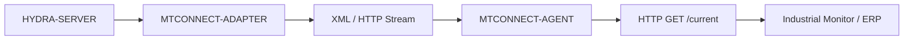

<!-- =============================================================================
HYDRA-UMC-MTCONNECT-ADAPTER - MTConnect probe/current/sample endpoints
Copyright (C) JuanenRac (Electro Hobby 3D) <electrohobby3d@gmail.com>
GPL-3.0-or-later - see LICENSE
============================================================================= -->

<p align="center">
  
</p>

# 🏭 HYDRA-UMC-MTCONNECT-ADAPTER

<p align="center"><a href="README.md">🇺🇸 English</a> | <a href="README_spa.md">🇪🇸 Español</a> | <a href="README_fra.md">🇫🇷 Français</a> | <a href="README_ita.md">🇮🇹 Italiano</a> | <a href="README_deu.md">🇩🇪 Deutsch</a> | <a href="README_zho.md">🇨🇳 简体中文</a> | <a href="README_jpn.md">🇯🇵 日本語</a> | 🇵🇹 <b>Português</b></p>

### 🛠️ Interface XML/HTTP padronizada para a monitorização de máquinas-ferramenta

<p align="center">
  
  
  
  
  
  
</p>

---

**Verificação de honestidade - o que realmente funciona hoje:** a conversão de unidades (`src/units.ts`), o mapeamento de qualidade/marca temporal/código de erro (`src/dataitem.ts`), a consulta periódica e a cache (`src/reader.ts`), o leitor de máquina apoiado no HYDRA-UMC-SERVER (`src/hydraServerReader.ts`) e o servidor HTTP (`src/server.ts`) são todos reais e testados (136 testes a passar em 13 ficheiros, incluindo pedidos HTTP reais por um socket de escuta real através do `supertest` - não apenas uma verificação de compilação). O modelo de dispositivo está fixado em exatamente um HydraNode (`hydra_umc_1`) - prova que a superfície HTTP e a forma do XML estão corretas segundo a especificação de ponta a ponta, mas uma implementação real que monitorize mais do que um robô teria de gerar isto a partir da lista em direto do próprio HYDRA-UMC-SERVER, o que ainda não acontece. O XML emitido foi verificado quanto à forma correta segundo a especificação (espaços de nomes, ids de `Device`/`DataItem`, um `instanceId` partilhado), mas ainda não foi testado em direto contra um Agent ou colector MTConnect real de terceiros. Veja o `CHANGELOG.md` para saber exatamente o que foi entregue até agora.

---

> **Estado de segurança (safety e security):** este ecossistema não é um sistema de segurança certificado. Ainda não existe um caminho de E-STOP por hardware, nem limites ou interlocks impostos pelo firmware, nem um comando de movimento verificado; as imagens de firmware são verificadas com CRC-32 e uma assinatura Ed25519, e uma compilação de versão recusa as chaves de desenvolvimento publicadas (as cabeças de ferramenta e as placas de expansão atrás do relé ainda usam os bootloaders do URTC, que aceitam um HMAC-SHA256 de chave partilhada em vez de uma assinatura); TLS e TLS mútuo são opcionais e estão desativados por defeito; nenhuma placa própria foi ainda montada ou testada. Leia a [base de segurança](https://github.com/JuanenRac/HYDRA-UMC-DOCS/blob/main/docs/SECURITY_BASELINE.md) e o [modelo de ameaças](https://github.com/JuanenRac/HYDRA-UMC-DOCS/blob/main/docs/THREAT_MODEL.md) antes de confiar em qualquer afirmação aqui para a segurança de uma pessoa.

---

## 📋 Num relance

| | |
|---|---|
| Versão | `0.2.0` |
| Maturidade | Funcional |
| Testes | 136 (`npm test`) |
| Tecnologia | Node.js / Express / MTConnect 1.7 XML |
| Destino | O Raspberry Pi CM5 de uma célula HYDRA-UMC |
| Em hardware real | Ainda não: não há registo de execução em hardware real para esta versão |

**Ir para:** [Visão geral](#-visão-geral) · [Arquitetura](#-arquitetura) · [Configuração](#-configuração) · [Início rápido](#-início-rápido) · [Testes](#-testes) · [Estrutura do repositório](#-estrutura-do-repositório) · [Projetos relacionados](#-projetos-relacionados)

## 🚦 Estado do projeto

Cada linha é uma parte deste repositório e a luz diz até onde chega hoje. É escrita com o que o repositório consegue demonstrar (testes, compilações, execuções), não com o que está previsto.

🟢 Feito e verificado · 🟡 Funciona, com limites conhecidos · 🟠 Feito a meio ou ainda por verificar · 🔴 Por fazer ou a não funcionar

| Área | Estado | O que significa aqui |
|---|---|---|
| Software | 🟡 | Funciona para o seu propósito principal; a verificação de honestidade acima lista o que ainda falta |
| Testes | 🟢 | 136 testes automáticos, executados a cada alteração |
| Hardware real | 🔴 | Ainda não: não há registo de execução em hardware real para esta versão |
| Documentação | 🟢 | README em oito idiomas, verificado contra o manifesto a cada alteração |

## 🎯 Visão geral

O **HYDRA-UMC-MTCONNECT-ADAPTER** é a ponte herdada e de padrão fabril para a monitorização de máquinas-ferramenta. Implementa o protocolo MTConnect (documentos da versão 1.7, verificados com o XSD oficial), expondo o enxame robótico como um conjunto de máquinas-ferramenta padronizadas.

Fornece uma interface XML/HTTP só de leitura que permite ao software industrial tradicional monitorizar o estado de execução, a disponibilidade e a temperatura do fuso do HydraNode sem precisar de controladores especializados.

### Funcionalidades principais:
* 🏭 **Dados de máquina padronizados:** expõe um HydraNode como um dispositivo compatível com o MTConnect. *(atualmente fixado em exatamente um HydraNode - `hydra_umc_1` - veja `docs/API.md`; prova que a superfície HTTP e a forma do XML estão corretas segundo a especificação de ponta a ponta, uma implementação real geraria isto a partir da lista em direto de robôs do próprio HYDRA-UMC-SERVER)*
* 📄 **Fluxos de dados XML:** os blocos `<Events>`/`<Samples>` reais e consultados periodicamente do `GET /current`, em formato XML padrão. *(implementado)*
* 🌐 **Interface HTTP:** acessível através de consultas RESTful simples para uma integração fácil. *(implementado)*
* 🔌 **Fonte de máquina real:** o `HydraServerMachineReader` (`src/hydraServerReader.ts`, `HYDRA_UMC_SERVER_URL`) consulta o `GET /api/settings` de um HYDRA-UMC-SERVER em direto e reporta o estado `AVAILABLE`/`ACTIVE`/`INTERRUPTED`/`STOPPED`/`READY` de um robô real - e não apenas o recurso `FixtureMachineReader`. Veja `docs/API.md`. *(implementado)*
* 🔍 **Compatibilidade com Agents:** verificado quanto à emissão de XML com a forma da especificação (espaços de nomes corretos, ids de `Device`/`DataItem` coerentes, um `instanceId` partilhado - veja `tests/server.test.ts`) - ainda não testado em direto contra um Agent/colector MTConnect real de terceiros.
* 📐 **Mapeamento real de unidades/qualidade:** a unidade nativa, a qualidade, a marca temporal UTC e o código de erro de cada DataItem são calculados por um mapeamento real e versionado - testável sem hardware. *(implementado)*
* 🩹 **Saída em modo degradado:** uma fonte que está em baixo ou que reporta dados inválidos é apresentada com o valor real `UNAVAILABLE` do próprio MTConnect, e não como uma falha nem como dados desatualizados; o documento continua válido segundo o esquema oficial. *(implementado)*
* 🧮 **Memória de observações:** cada alteração de um DataItem é uma observação com o seu próprio número de sequência, guardada numa memória de `MTCONNECT_BUFFER_SIZE` observações; `GET /sample?from=<nextSequence>&count=<n>` devolve exatamente o que aconteceu desde então, pelo que um ciclo de cliente nunca perde nem repete uma alteração. *(implementado)*
* 🧪 **Sem dados inventados:** sem `HYDRA_UMC_SERVER_URL`, todos os DataItems estão `UNAVAILABLE`; os valores sintéticos de demonstração só são servidos com `HYDRA_UMC_MTCONNECT_DEMO=1`, e o dispositivo indica-o na sua descrição. *(implementado)*
* 🧩 **Condições, rotas por dispositivo e estados HTTP:** um DataItem CONDITION é apresentado como Normal, Warning, Fault ou Unavailable (com a sua mensagem e o código nativo) e declarado em `/probe` quando o dispositivo tem algum; o dispositivo declara `ASSET_CHANGED` e `ASSET_REMOVED` (não tem ativos, por isso ficam UNAVAILABLE); `/HydraNode_1/probe`, `/current` e `/sample` respondem por esse dispositivo; `HYDRA_UMC_MTCONNECT_HTTP_ERRORS=1` faz um MTConnectError levar HTTP 400 ou 404 em vez de 200 (desligado por defeito). Tudo verificado com o XSD oficial. *(implementado)*
* 🔌 **Saída SHDR para um cppagent:** com `HYDRA_UMC_MTCONNECT_SHDR_PORT` definido, o adaptador serve também as mesmas observações como linhas SHDR (`hora|dataItemId|valor`, condições como `hora|id|NÍVEL|códigoNativo|||mensagem`) por TCP, para que um agente MTConnect corrente o possa ler. Um cliente recebe primeiro o último valor de cada DataItem e depois cada alteração; a única linha que pode enviar é `* PING`, respondida com `* PONG`. Só de leitura. Escuta em `127.0.0.1`, a não ser que `HYDRA_UMC_MTCONNECT_SHDR_HOST` diga outra coisa. Testado com um agente simulado. *(implementado, ainda não experimentado com um cppagent real)*
* 🔌 **Lê o fluxo SHDR da ponte CNC (opcional):** com `HYDRA_UMC_MTCONNECT_SHDR_SOURCE=anfitrião:porta` o agente obtém a execução e a disponibilidade da máquina a partir da saída SHDR de outro adaptador; uma ligação perdida mostra todos os DataItem como indisponíveis em vez dos últimos valores. Só de leitura.

## 🧩 Papel no HYDRA-UMC

O **HYDRA-UMC-MTCONNECT-ADAPTER** mostra os robôs ao software de monitorização de fábrica como dispositivos MTConnect: XML só de leitura sobre HTTP (`/probe`, `/current`, `/sample`), alimentado a partir do `HYDRA-UMC-SERVER`. Não envia nenhum comando a nenhuma máquina.

## 🏛️ Arquitetura

<p align="center">
  
</p>

<details>
<summary>Versão em texto do diagrama (Mermaid)</summary>



</details>

### ARQUITETURA E DECISÕES DE DESENHO

* **Porque é um irmão, e não um submódulo, do HYDRA-UMC-GATEWAY-INDUSTRIAL.** Cada adaptador de protocolo é um processo implementável/reiniciável em separado - um problema na geração de XML do MTConnect nunca derruba os adaptadores OPC-UA ou MQTT que correm a seu lado.
* **Porque um fluxo real de dispositivo/agent MTConnect e não uma exportação XML genérica.** O software fabril compatível com o MTConnect (muitas ferramentas de CNC/MES) espera o esquema específico de dispositivo/agent/componente que o padrão define - uma exportação genérica exigiria um analisador à medida do outro lado, o que anula o sentido de falar MTConnect.
* **Porque o ponto de entrada só imprime a identidade/versão e termina depois de um ouvinte de verificação de saúde arrancar.** Fase de andaimes (scaffolding), o mesmo raciocínio do README do projeto-mãe - um adaptador real é, por natureza, de execução prolongada.
* **Como isto se encaixa no resto do ecossistema.** Um serviço irmão sob o HYDRA-UMC-GATEWAY-INDUSTRIAL - traduz o estado do próprio HYDRA-UMC-SERVER num fluxo real de dispositivo/agent MTConnect.
* **Testes HTTP reais, não apenas uma verificação de compilação.** O `tests/server.test.ts` usa o `supertest` (um pedido HTTP real por um socket de escuta real) para verificar que o `GET /probe` e o `GET /current` devolvem XML com a forma da especificação, com espaços de nomes coincidentes, ids de `Device`/`DataItem` coerentes entre os dois documentos e um `instanceId` partilhado.
* **Porque a conversão de unidades, a classificação de qualidade e a leitura de uma máquina são três módulos separados.** O `src/units.ts` (matemática pura de conversão), o `src/dataitem.ts` (mapeamento de qualidade/marca temporal/código de erro) e o `src/reader.ts` (consulta periódica/cache de um `MachineReader`) são testáveis cada um por si, sem hardware nem HTTP - uma preocupação explícita: os erros de conversão de unidades encontrados através de uma ida e volta HTTP completa são lentos de isolar e fáceis de deixar passar.
* **Porque um DataItem degradado apresenta o valor real `UNAVAILABLE` do MTConnect e não uma forma de erro própria.** Os agentes e clientes MTConnect já sabem apresentar `UNAVAILABLE`: reutilizar o vocabulário da própria especificação significa que uma ferramenta a jusante degrada-se com elegância já hoje. O motivo (sem dados, conversão de unidades, fonte em baixo, desatualizado) fica fora do documento: o esquema oficial não tem atributo para isso e um analisador que valida rejeita um documento que leve um a mais.
* **Porque o limite de consulta do `CachedReader` é genérico e não fixado ao `spindle_temp`.** O risco real que protege - bombardear um controlador com décadas com pedidos de cada vez que o `/current` é consultado - aplica-se igualmente ao `FixtureMachineReader` e ao `HydraServerMachineReader` real (`src/hydraServerReader.ts`, que consulta o `GET /api/settings` de um HYDRA-UMC-SERVER em direto para o estado real dos robôs), pelo que o travão vive ao nível da interface `MachineReader` e não dentro do tratamento de um só DataItem.

## ⚙️ Configuração

A porta de escuta é lida primeiro de `HYDRA_UMC_MTCONNECT_PORT` (5000 por predefinição). O `PORT` partilhado continua a valer como último recurso e mostra um aviso, para que um ficheiro de ambiente partilhado por vários serviços não possa mudar o agente para a porta de outro serviço por acidente; um valor definido mas que não é uma porta válida interrompe o arranque, e a verificação de saúde do contentor segue a mesma ordem.

## 🚀 Início rápido

Requer Node.js 20 ou superior com npm.

```bash
npm install
npm test
npm run build
npm start
curl http://127.0.0.1:5000/probe
```

## 🧪 Testes

136 testes automáticos correm com `npm test`. Não precisam de hardware nem de nada fora desta máquina.

A CI executa `HYDRA_UMC_CI=1 python tools/ci_validate.py`, que verifica o manifesto, os documentos, os oito README e as imagens.

## 🏗️ Compilação e publicação

### Requisitos
- [Node.js](https://nodejs.org/) (v20 ou superior recomendado)
- npm

### Instalação
```bash
npm install
```

### Modo de desenvolvimento
Executa o adaptador diretamente com o `tsx` (sem empacotador):
- **Windows:** faça duplo clique em `dev.bat` ou execute `npm run dev`
- **Linux/Mac:** execute `./dev.sh` ou `npm run dev`

### Compilação de produção
Empacota o adaptador num único ficheiro implementável com o esbuild:
- **Windows:** faça duplo clique em `build.bat` ou execute `npm run build`
- **Linux/Mac:** execute `./build.sh` ou `npm run build`

Depois arranque-o com:
```bash
npm start
```

O adaptador escuta em `0.0.0.0:5000` - qualquer Agent/colector MTConnect pode
consultar `GET http://<host>:5000/probe` (modelo estático do dispositivo),
`GET http://<host>:5000/current` (últimos valores dos DataItems) e
`GET http://<host>:5000/sample?from=<sequência>` (semântica real e honesta de
memória intermédia de fluxo - veja `docs/API.md`).

Para reportar um robô real, defina `HYDRA_UMC_SERVER_URL`. O HYDRA-UMC-SERVER só responde a `GET /api/settings` a uma conta com sessão iniciada, pelo que deve dar também uma credencial ao adaptador: `HYDRA_UMC_SERVER_TOKEN` (um token que o servidor já emitiu), ou `HYDRA_UMC_SERVER_USER` e `HYDRA_UMC_SERVER_PASSWORD` (o adaptador inicia sessão por si e volta a fazê-lo quando a sessão expira). Sem nenhuma, a fonte é reportada como indisponível (`SOURCE_UNAVAILABLE`). O `HYDRA_UMC_MTCONNECT_HOST` restringe o endereço de escuta (por omissão `0.0.0.0`), por exemplo a `127.0.0.1` atrás de um proxy inverso local. As respostas do servidor são lidas até 4 MiB.

### Versionamento
`npm run build` apenas empacota o servidor. A versão só é subida por `python tools/hydra_project_tool.py bump` (através de `bump_manifest_version.py`), um "conta-quilómetros" em base 10: patch +1 por bump, com transporte para minor (e de minor para major) depois de 9, em vez de alguma vez chegar a um segmento de dois dígitos (`0.0.9` -> `0.1.0`, não `0.0.10`).

## 📂 Estrutura do repositório

<p align="center">
  
</p>

<details>
<summary>Versão em texto da árvore</summary>

```text
HYDRA-UMC-MTCONNECT-ADAPTER/
├── src/                       Código-fonte (Node/TypeScript - Adapter, Mapper, HTTP)
├── tests/                     Suite Vitest - mapeamento de data items, unidades, leitor e comportamento do servidor
├── docs/                      documentos do projeto
├── images/                    Multimédia e diagramas
├── schemas/                   mtconnect-1.7/: os esquemas XSD do MTConnect 1.7 contra os quais as respostas são validadas, com a sua NOTICE
├── scripts/                   Scripts utilitários (bump-version.mjs)
├── tools/                     build_test.py (verificação de compilação sem versionar), ci_validate.py (validação de manifesto/CHANGELOG/docs usada pela CI), hydra_project_tool.py e os partilhados _doc_policy.py e _readme_parity.py
├── .github/                   fluxo de CI e modelos de problemas
├── CHANGELOG.md               o que mudou em cada versão
├── Dockerfile                 imagem de contentor
├── build-test.sh              verificação de compilação sem alterações
├── build.sh                   compila e verifica; nunca muda a versão
├── bump_manifest_version.py   sincroniza a versão do manifesto
├── dev.sh                     modo de desenvolvimento
├── hydra-umc.project.json     manifesto: versão, maturidade, família
├── package.json               metadados e scripts do pacote
└── test.sh                    executa os testes
```

</details>

## 🗺️ Roteiro e limites conhecidos

**Limites conhecidos hoje**

* **Fase 1:** implementação de OPC-UA Pub/Sub para troca de dados a alta velocidade e ponte com protocolos herdados.
* **Fase 2:** cluster de broker MQTT para gestão massiva de dispositivos IoT e elevada concorrência.
* **Fase 3:** suporte do adaptador MTConnect para a integração de maquinaria CNC e PLC de vários fabricantes.
* **Fase 4:** suporte à agregação de vários dispositivos MTConnect e ao envio padronizado de telemetria XML/HTTP em fluxo.

## 🌍 Idiomas

Este README e os documentos do repositório existem em oito idiomas: inglês, espanhol, alemão, francês, italiano, japonês, chinês e português (Portugal). São escritos em conjunto e a CI verifica que os oito ficheiros têm as mesmas secções e as mesmas ligações. Este repositório não tem ecrã nem catálogo de mensagens próprios, por isso não há textos de interface para traduzir.

## 🔗 Projetos relacionados

Este projeto faz parte do ecossistema de robótica HYDRA-UMC do mesmo autor (JuanenRac / Electro Hobby 3D). Vale a pena conhecê-los, porque um pedido pode ser, na verdade, sobre um destes e não sobre este repositório.

**Projeto-mãe**
- **[HYDRA-UMC-GATEWAY-INDUSTRIAL](https://github.com/JuanenRac/HYDRA-UMC-GATEWAY-INDUSTRIAL)** — centro de integração que retransmite para protocolos industriais, com uma camada real de lista de comandos permitidos e contrapressão; o projeto-mãe de que este repositório é um adaptador de protocolo específico, dentro da sua própria gateway industrial.

**Projetos irmãos** — os outros adaptadores de protocolo da própria gateway industrial do HYDRA-UMC-GATEWAY-INDUSTRIAL
- **[HYDRA-UMC-OPCUA-SERVER](https://github.com/JuanenRac/HYDRA-UMC-OPCUA-SERVER)** — espaço de endereços OPC-UA real, verificado com uma sessão de cliente real do protocolo binário.
- **[HYDRA-UMC-MQTT-BROKER](https://github.com/JuanenRac/HYDRA-UMC-MQTT-BROKER)** — broker MQTT real com autenticação opcional por cliente e ACL de tópicos.

**Diretamente relacionados**
- **[HYDRA-UMC-SERVER](https://github.com/JuanenRac/HYDRA-UMC-SERVER)** — o back-end headless real (REST/WebSocket) com que todos os clientes de controlo realmente comunicam — a origem do estado que este adaptador expõe.

**Também fazem parte do ecossistema**

*Hardware e plataforma centrais*
- **[HYDRA-UMC](https://github.com/JuanenRac/HYDRA-UMC)** — o desenho da placa-mãe do braço robótico: anfitrião CM5 + STM32H745 de dois núcleos, pensado para orquestrar até 8 braços de ferramenta por CAN-OTA/SPI-OTA (firmware numa fase inicial; ainda sem placa montada).
- **[HYDRA-UMC-OS](https://github.com/JuanenRac/HYDRA-UMC-OS)** — camada de produto reproduzível do Raspberry Pi OS para o CM5: agente só de leitura, configuração/perfis validados, aprovisionamento Wi-Fi de primeiro contacto.
- **[HYDRA-UMC-SDK](https://github.com/JuanenRac/HYDRA-UMC-SDK)** — o contrato JSON-Schema partilhado e a fronteira de software de controlo de trabalhos contra a qual cada bridge valida os seus comandos (não é uma função de segurança certificada).
- **[HYDRA-UMC-CONNECTOR-HUB](https://github.com/JuanenRac/HYDRA-UMC-CONNECTOR-HUB)** — registo declarativo de manifestos de adaptador e validador para conectores de máquinas externas; estende a ideia de contrato do SDK a máquinas externas sem substituir os projetos de gateway industrial.

*Backend central e clientes*
- **[HYDRA-UMC-STUDIO](https://github.com/JuanenRac/HYDRA-UMC-STUDIO)** — painel web de controlo com visualização 3D em tempo real de vários robôs.
- **[HYDRA-UMC-SUITE](https://github.com/JuanenRac/HYDRA-UMC-SUITE)** — centro de comando de enxame para desktop (PySide6) para vários servidores ao mesmo tempo, empacotado como executável independente.
- **[HYDRA-UMC-ANDROID-CONTROL](https://github.com/JuanenRac/HYDRA-UMC-ANDROID-CONTROL)** — aplicação Android nativa de controlo, com início de sessão biométrico e um companheiro Wear OS emparelhado.
- **[HYDRA-UMC-IOS-CONTROL](https://github.com/JuanenRac/HYDRA-UMC-IOS-CONTROL)** — aplicação de controlo para iOS/iPadOS (Flutter) com sincronização WebSocket em tempo real.
- **[HYDRA-UMC-DSI](https://github.com/JuanenRac/HYDRA-UMC-DSI)** — interface tátil nativa para o ecrã tátil DSI de 7" integrado, executada no próprio CM5.
- **[HYDRA-UMC-EDITOR-URDF](https://github.com/JuanenRac/HYDRA-UMC-EDITOR-URDF)** — criador/editor gráfico de URDF para desktop que envia os modelos concluídos para o catálogo do STUDIO.
- **[HYDRA-UMC-EDITOR-STL](https://github.com/JuanenRac/HYDRA-UMC-EDITOR-STL)** — editor de modelos STL para desktop que transforma/substitui/remove/adiciona peças reais no mesmo catálogo de modelos que o HYDRA-UMC-EDITOR-URDF também edita.
- **[HYDRA-UMC-BRIDGE-AMR](https://github.com/JuanenRac/HYDRA-UMC-BRIDGE-AMR)** — fronteira de coordenação para frotas AGV/AMR através de um publicador MQTT VDA 5050 (testado apenas contra uma frota emulada).
- **[HYDRA-UMC-BRIDGE-CNC](https://github.com/JuanenRac/HYDRA-UMC-BRIDGE-CNC)** — coordenador de células CNC de alto nível com acesso ao estado GRBL e aos bytes de controlo (testado apenas contra um emulador).
- **[HYDRA-UMC-BRIDGE-DROIDS](https://github.com/JuanenRac/HYDRA-UMC-BRIDGE-DROIDS)** — fronteira de coordenação para droides com patas/humanoides, com um emissor de comandos para o Boston Dynamics Spot (testado apenas contra um emulador).
- **[HYDRA-UMC-BRIDGE-LASER](https://github.com/JuanenRac/HYDRA-UMC-BRIDGE-LASER)** — coordenador de células laser que lê 3 sinais GPIO (chave, caixa e interlock) (testado apenas contra um chip simulado; não pode armar nem disparar um laser).
- **[HYDRA-UMC-BRIDGE-OPENPNP](https://github.com/JuanenRac/HYDRA-UMC-BRIDGE-OPENPNP)** — coordenador seguro de fluxo de placa de alto nível para pick-and-place com OpenPnP.
- **[HYDRA-UMC-BRIDGE-PRINTER3D](https://github.com/JuanenRac/HYDRA-UMC-BRIDGE-PRINTER3D)** — fronteira de coordenação segura para impressoras 3D Moonraker/Klipper, com comandos de trabalho reais protegidos por portas.
- **[HYDRA-UMC-BRIDGE-ROS2](https://github.com/JuanenRac/HYDRA-UMC-BRIDGE-ROS2)** — coordenador com um transporte ROS 2 baseado em rclpy importado sob demanda (ainda não executado contra uma instalação ROS 2).
- **[HYDRA-UMC-BRIDGE-UAV](https://github.com/JuanenRac/HYDRA-UMC-BRIDGE-UAV)** — fronteira de coordenação para UAV com câmara, com um emissor de comandos MAVLink (testado apenas contra um emulador).

*Plataforma de ferramentas URTC*
- **[URTC](https://github.com/JuanenRac/URTC)** — firmware da placa física Universal Robot Tool Controller, mais de 25 perfis de ferramenta por barramento CAN.
- **[URTC-FLASHER](https://github.com/JuanenRac/URTC-FLASHER)** — ferramenta gráfica de gravação para desktop das placas URTC, por CAN-OTA e também SWD/JTAG de chip completo.
- **[URTC-TESTER](https://github.com/JuanenRac/URTC-TESTER)** — ferramenta de diagnóstico CAN em tempo real para desktop das placas URTC, com um painel por perfil de ferramenta.
- **[URTC-WEB-STUDIO](https://github.com/JuanenRac/URTC-WEB-STUDIO)** — alternativa no navegador ao URTC-TESTER através da Web Serial API, sem instalação local.
- **[URTC-GATEWAY](https://github.com/JuanenRac/URTC-GATEWAY)** — gateway à frente do barramento CAN do URTC: lista de identificadores permitidos, limite de taxa e chave de sessão; software testado num computador, ainda não num barramento real.

*Nó de IA de visão (Hailo-8)*
- **[HYDRA-UMC-VISION-NODE](https://github.com/JuanenRac/HYDRA-UMC-VISION-NODE)** — centro de integração do pipeline de visão Hailo-8, com uma verificação real de prontidão de hardware por fase.
- **[HYDRA-UMC-DETECTION-HEF](https://github.com/JuanenRac/HYDRA-UMC-DETECTION-HEF)** — registo real de modelos compilados com verificação segura de carga por arquitetura Hailo e soma de verificação.
- **[HYDRA-UMC-VISION-STREAMER](https://github.com/JuanenRac/HYDRA-UMC-VISION-STREAMER)** — pipeline GStreamer real e gerador de configuração MediaMTX com uma fronteira de integração HailoRT real.
- **[HYDRA-UMC-VISUAL-SERVOING-API](https://github.com/JuanenRac/HYDRA-UMC-VISUAL-SERVOING-API)** — lei de correção de servovisão baseada em posição com autorização condicionada ao estado da zona; ainda sem estimativa de pose por câmara.
- **[HYDRA-UMC-SAFETY-ZONES](https://github.com/JuanenRac/HYDRA-UMC-SAFETY-ZONES)** — lógica v0 de violação de zonas, atualidade da calibração e pedido de E-STOP que lê as posições dos objetos de um ficheiro; nenhum detetor a alimenta e ainda não há E-STOP físico ligado.

*Nó de IA cognitiva (Hailo-10)*
- **[HYDRA-UMC-COGNITIVE-NODE](https://github.com/JuanenRac/HYDRA-UMC-COGNITIVE-NODE)** — centro de integração do pipeline cognitivo do Hailo-10 (orquestração de LLM/VLA/voz).
- **[HYDRA-UMC-VLA-ENGINE](https://github.com/JuanenRac/HYDRA-UMC-VLA-ENGINE)** — codificação/descodificação real de tokens de ação e geração de trajetórias para um modelo Visão-Linguagem-Ação.
- **[HYDRA-UMC-VOICE-UI](https://github.com/JuanenRac/HYDRA-UMC-VOICE-UI)** — front-end de voz real (VAD + analisador de intenções) com um relé para o relógio limitado e protegido por confirmação.
- **[HYDRA-UMC-SEMANTIC-PLANNER](https://github.com/JuanenRac/HYDRA-UMC-SEMANTIC-PLANNER)** — decomposição real de tarefas baseada em regras e recuperação semântica de erros sobre os códigos de erro do MCU.
- **[HYDRA-UMC-DOCS-QA](https://github.com/JuanenRac/HYDRA-UMC-DOCS-QA)** — pesquisa real de documentos TF-IDF só com a biblioteca padrão sobre a documentação Markdown deste ecossistema.
- **[HYDRA-UMC-LOCAL-TECHNICIAN](https://github.com/JuanenRac/HYDRA-UMC-LOCAL-TECHNICIAN)** — técnico de manutenção de IA local, protegido por políticas, para o próprio ecossistema: observa, diagnostica e propõe correções; os dois níveis de maior risco não estão implementados de propósito.

*Orquestração e enxame*
- **[HYDRA-UMC-ORCHESTRATOR](https://github.com/JuanenRac/HYDRA-UMC-ORCHESTRATOR)** — centro de integração com um contrato real de relatório de saúde gRPC/Protobuf e uma máquina de estados de missões.
- **[HYDRA-UMC-JOB-DISPATCHER](https://github.com/JuanenRac/HYDRA-UMC-JOB-DISPATCHER)** — fila real de trabalhos por prioridade com deduplicação, sobre uma API HTTP real.
- **[HYDRA-UMC-NODE-HEALING](https://github.com/JuanenRac/HYDRA-UMC-NODE-HEALING)** — vigilante real de saúde da frota por gRPC com repetição/recuo e deteção de identidade incoerente.
- **[HYDRA-UMC-PATH-PLANNER-3D](https://github.com/JuanenRac/HYDRA-UMC-PATH-PLANNER-3D)** — planeador real de trajetórias 3D baseado em RRT com validação real de colisões com obstáculos e espaço de trabalho.
- **[HYDRA-UMC-SWARM-SYNC](https://github.com/JuanenRac/HYDRA-UMC-SWARM-SYNC)** — sincronização real de estado CRDT LWW-Element-Map, testada por propriedades para a convergência de várias células.

*Gémeo digital e simulação*
- **[HYDRA-UMC-TWIN](https://github.com/JuanenRac/HYDRA-UMC-TWIN)** — centro de integração do motor de gémeo digital, com um contrato real de sincronização de compatibilidade de versões.
- **[HYDRA-UMC-HIL-BRIDGE](https://github.com/JuanenRac/HYDRA-UMC-HIL-BRIDGE)** — encaminhador hardware-in-the-loop com um interlock de software de colisão entre a simulação e o hardware real (testado sem hardware real).
- **[HYDRA-UMC-PHYSICS-REPLICA](https://github.com/JuanenRac/HYDRA-UMC-PHYSICS-REPLICA)** — cinemática direta real e validação de limites de juntas sobre um subconjunto real de URDF.
- **[HYDRA-UMC-SYNTHETIC-DATA-GEN](https://github.com/JuanenRac/HYDRA-UMC-SYNTHETIC-DATA-GEN)** — gerador procedural real de cenas 2D com exportação de anotações YOLO/COCO.

*Dados e análise*
- **[HYDRA-UMC-DATALAKE](https://github.com/JuanenRac/HYDRA-UMC-DATALAKE)** — armazém real de séries temporais sobre sqlite3 com uma API HTTP real de ingestão/consulta.
- **[HYDRA-UMC-ANOMALY-DETECTOR](https://github.com/JuanenRac/HYDRA-UMC-ANOMALY-DETECTOR)** — detetor real de anomalias por FFT e linha de base estatística, com monitorização de deriva.
- **[HYDRA-UMC-PRODUCTION-REPORTS](https://github.com/JuanenRac/HYDRA-UMC-PRODUCTION-REPORTS)** — cálculo real de OEE/disponibilidade sobre o histórico do DATALAKE, com exportação CSV reprodutível.
- **[HYDRA-UMC-TELEMETRY-COLLECTOR](https://github.com/JuanenRac/HYDRA-UMC-TELEMETRY-COLLECTOR)** — pipeline real de ingestão CAN/WebSocket para o DATALAKE, com deduplicação por sequência.

*Ferramentas complementares e operações do ecossistema*
- **[HYDRA-UMC-DASHBOARD-AI](https://github.com/JuanenRac/HYDRA-UMC-DASHBOARD-AI)** — painéis de Resumos Inteligentes e Realce de Anomalias sobre o DATALAKE/ANOMALY-DETECTOR, com um recurso estatístico honesto.
- **[HYDRA-UMC-TOOL-CLI](https://github.com/JuanenRac/HYDRA-UMC-TOOL-CLI)** — CLI da frota com um contrato de códigos de saída real e estável, um cliente vivo genuíno da API do HYDRA-UMC-SERVER.
- **[HYDRA-UMC-WATCH](https://github.com/JuanenRac/HYDRA-UMC-WATCH)** — aplicação companheira WearOS com padrões de alerta tátil e um relé de voz para o telemóvel emparelhado (ainda não executada num relógio físico).
- **[URTC-SMART-RACK](https://github.com/JuanenRac/URTC-SMART-RACK)** — firmware de um rack de montagem de placas com descodificação real do ID da ferramenta e lógica de pré-aquecimento Smart Idle.
- **[URTC-VISION-TOOL](https://github.com/JuanenRac/URTC-VISION-TOOL)** — firmware mais um companheiro de visão em Python real para uma cabeça de ferramenta de inspeção térmica/RGB.
- **[HYDRA-UMC-UPDATER](https://github.com/JuanenRac/HYDRA-UMC-UPDATER)** — ferramenta administrativa de desktop que descobre, clona e atualiza todos os repositórios deste ecossistema.
- **[HYDRA-UMC-OS-REBUILDER](https://github.com/JuanenRac/HYDRA-UMC-OS-REBUILDER)** — ferramenta de desktop para Windows/Linux que constrói uma imagem do CM5 pronta a gravar com as versões mais recentes do ecossistema, com configuração de primeiro arranque de Wi-Fi/utilizador/SSH ao estilo do Raspberry Pi Imager.
- **[HYDRA-UMC-OPS-AGENT](https://github.com/JuanenRac/HYDRA-UMC-OPS-AGENT)** — coordenador de incidentes de manutenção: um papel de borda de poucos privilégios recolhe um inventário/estado higienizado, um papel de plano de controlo mostra-o só de leitura e pede a um fornecedor de IA que sugira um diagnóstico; nunca aplica um patch nem implanta nada.
- **[HYDRA-UMC-DEV-SERVER](https://github.com/JuanenRac/HYDRA-UMC-DEV-SERVER)** — anfitrião de desenvolvimento reproduzível (Raspberry Pi 5 / CM5) que guarda o código-fonte do ecossistema e executa tarefas limitadas de compilação/teste numa fila durável; um papel de desenvolvimento dedicado, explicitamente não um CM5 operacional.

## 📚 Documentação

Onde ler mais:

* **[docs/API.md](docs/API.md)** — a referência real dos endpoints HTTP: a forma dos pedidos/respostas de `GET /probe`/`GET /current`/`GET /sample`, envelopes XML de exemplo completos, as duas implementações reais de `MachineReader` (`FixtureMachineReader`/`HydraServerMachineReader`) e uma indicação explícita do que ainda é provisório (o único HydraNode fixado - a árvore dinâmica, com um Device por robô, é um trabalho à parte e maior).
* [Base de segurança do ecossistema](https://github.com/JuanenRac/HYDRA-UMC-DOCS/blob/main/docs/SECURITY_BASELINE.md)
* [Modelo de ameaças do ecossistema](https://github.com/JuanenRac/HYDRA-UMC-DOCS/blob/main/docs/THREAT_MODEL.md)
* [Registo de alterações deste repositório](CHANGELOG.md)
* [Licença deste repositório](LICENSE.md)

## 🤝 Contribuir e comunidade

* Antes de um pull request execute `HYDRA_UMC_CI=1 py -3 tools/ci_validate.py` (ou `HYDRA_UMC_CI=1 python3 tools/ci_validate.py`): tem de imprimir `CI_VALIDATION=PASS`. Não execute `build.sh` nem `build.bat` para esta verificação; compilar não é verificar.
* Os oito README são escritos a partir de uma única fonte em HYDRA-UMC-DOCS; não os edite à mão. Altere a fonte e escreva-os de novo com `tools/make_readmes.py`.
* Não afirme num README o que não foi executado: diga «simulado» ou «não testado em hardware» quando for a verdade.
* Consulte [CONTRIBUTING.md](CONTRIBUTING.md), o [código de conduta](CODE_OF_CONDUCT.md), [SECURITY.md](SECURITY.md) e [SUPPORT.md](SUPPORT.md).

## 👤 AUTOR

**JuanenRac (Electro Hobby 3D)** · electrohobby3d@gmail.com

## 📜 LICENÇA

GPL-3.0-or-later - [LICENSE](LICENSE).
