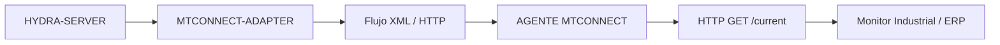

<p align="center">
  
</p>

# 🏭 HYDRA-UMC-MTCONNECT-ADAPTER

<p align="center"><a href="README.md">🇺🇸 English</a> | 🇪🇸 <b>Español</b> | <a href="README_fra.md">🇫🇷 Français</a> | <a href="README_ita.md">🇮🇹 Italiano</a> | <a href="README_deu.md">🇩🇪 Deutsch</a> | <a href="README_zho.md">🇨🇳 简体中文</a> | <a href="README_jpn.md">🇯🇵 日本語</a> | <a href="README_por.md">🇵🇹 Português</a></p>

### 🛠️ Interfaz XML/HTTP Estandarizada para Monitorización de Máquinas Herramienta

<p align="center">
  
  
  
</p>

---

**Comprobación de honestidad - qué funciona realmente hoy:** la conversión de unidades (`src/units.ts`), el mapeo de calidad/timestamp/código de error (`src/dataitem.ts`), el sondeo/caché (`src/reader.ts`), el lector de máquina real respaldado por HYDRA-UMC-SERVER (`src/hydraServerReader.ts`), y el servidor HTTP (`src/server.ts`) son todos reales y están testeados (122 tests pasando en 11 archivos, incluyendo peticiones HTTP reales sobre un socket real en escucha vía `supertest` - no solo una comprobación de compilación). El modelo de dispositivo está fijado a exactamente un HydraNode (`hydra_umc_1`) - demuestra que la superficie HTTP y la forma XML son correctas según el spec de extremo a extremo, pero un despliegue real que monitorice más de un robot necesitaría generar esto a partir del propio listado en vivo de HYDRA-UMC-SERVER, lo cual todavía no ocurre. El XML emitido se ha verificado con una forma correcta según el spec (namespaces, ids de `Device`/`DataItem`, un `instanceId` compartido) pero todavía no se ha testeado en vivo contra un Agente/colector MTConnect de terceros real. Ver `CHANGELOG.md` para lo que se ha entregado exactamente hasta ahora.

---

> **Estado de seguridad física y de ciberseguridad:** este ecosistema no es un sistema de seguridad certificado. Todavía no existe una ruta de E-STOP por hardware, ni límites ni enclavamientos aplicados por el firmware, ni un comando de movimiento verificado; las imágenes de firmware se comprueban con CRC32 y un HMAC-SHA256 de clave compartida, no con una firma asimétrica; TLS y TLS mutuo son opcionales y están desactivados por defecto; aún no se ha poblado ni probado ninguna placa propia. Lee la [línea base de seguridad](https://github.com/JuanenRac/HYDRA-UMC-DOCS/blob/main/docs/SECURITY_BASELINE.md) y el [modelo de amenazas](https://github.com/JuanenRac/HYDRA-UMC-DOCS/blob/main/docs/THREAT_MODEL.md) antes de fiarte de cualquier afirmación de aquí para la seguridad de una persona.

## 📋 De un vistazo

| | |
|---|---|
| Versión | `0.1.9` |
| Madurez | Funcional |
| Tests | 115 |
| Tecnología | Node.js / Express / ANSI/MTC1.4 XML |
| Destino | La Raspberry Pi CM5 de una celda HYDRA-UMC |
| En hardware real | Todavía no: no consta ninguna ejecución en hardware real para esta versión |

## 🚦 Estado del proyecto

Cada línea es una parte de este repositorio y la luz dice hasta dónde llega hoy. Se escribe con lo que el repositorio puede demostrar (pruebas, compilaciones, ejecuciones), no con lo previsto.

🟢 Hecho y verificado · 🟡 Funciona, con límites conocidos · 🟠 Hecho a medias o sin verificar · 🔴 Sin hacer o sin funcionar

| Área | Estado | Qué significa aquí |
|---|---|---|
| Software | 🟡 | Funciona para su propósito principal; la comprobación de honestidad de arriba lista lo que aún falta |
| Pruebas | 🟢 | 115 pruebas automáticas, ejecutadas en cada cambio |
| Hardware real | 🔴 | Todavía no: no consta ninguna ejecución en hardware real para esta versión |
| Documentación | 🟢 | README en ocho idiomas, comprobado contra el manifiesto en cada cambio |

## 1. 🛠️ VISIÓN GENERAL TÉCNICA

**HYDRA-UMC-MTCONNECT-ADAPTER** es el puente estándar de fábrica y legado para la monitorización de máquinas herramienta. Implementa el protocolo MTConnect (documentos de la versión 1.7, comprobados con el XSD oficial), exponiendo el enjambre robótico como un conjunto de máquinas herramienta estandarizadas.

Proporciona una interfaz XML/HTTP de solo lectura que permite que el software industrial tradicional monitorice el estado de ejecución, la disponibilidad y la temperatura del husillo del HydraNode sin necesidad de drivers especializados.

### Características Clave:
* 🏭 **Datos de Máquina Estandarizados:** Expone un HydraNode como dispositivo compatible con MTConnect. *(hoy fijo a exactamente un HydraNode - `hydra_umc_1` - ver `docs/API.md`; demuestra que la superficie HTTP y la forma XML son correctas de extremo a extremo según la especificación; un despliegue real generaría esto desde el propio listado de robots en vivo de HYDRA-UMC-SERVER)*
* 📄 **Flujos de Datos XML:** Los bloques `<Events>`/`<Samples>` reales y sondeados de `GET /current` en formato XML estándar. *(implementado)*
* 🔌 **Fuente de máquina real:** `HydraServerMachineReader` (`src/hydraServerReader.ts`, `HYDRA_UMC_SERVER_URL`) consulta un HYDRA-UMC-SERVER real en vivo mediante su propio `GET /api/settings` y reporta el estado real (`AVAILABLE`/`ACTIVE`/`INTERRUPTED`/`STOPPED`/`READY`) de un robot real - no solo el respaldo `FixtureMachineReader`. Ver `docs/API.md`. *(implementado)*
* 🌐 **Interfaz HTTP:** Accesible a través de simples consultas RESTful para una fácil integración. *(implementado)*
* 🔍 **Compatibilidad con Agentes:** Verificado que emite XML con la forma correcta según la especificación (namespaces correctos, ids `Device`/`DataItem` consistentes, un `instanceId` compartido - ver `tests/server.test.ts`) - todavía no probado en vivo contra un Agente/colector MTConnect real de terceros.
* 📐 **Mapeo Real de Unidad/Calidad:** La unidad nativa, la calidad, el timestamp UTC y el código de error de cada DataItem se calculan mediante un mapeo real y versionado - testeable sin hardware. *(implementado)*
* 🩹 **Salida en Modo Degradado:** Una fuente caída o que informa datos inválidos se muestra con el valor real `UNAVAILABLE` del propio MTConnect, no como un fallo ni como datos obsoletos; el documento sigue siendo válido según el esquema oficial. *(implementado)*
* 🧮 **Búfer de Observaciones:** cada cambio de un DataItem es una observación con su propio número de secuencia, guardada en un búfer de `MTCONNECT_BUFFER_SIZE` observaciones; `GET /sample?from=<nextSequence>&count=<n>` devuelve exactamente lo ocurrido desde entonces, de modo que un bucle de cliente nunca pierde ni repite un cambio. *(implementado)*
* 🧪 **Sin datos inventados:** sin `HYDRA_UMC_SERVER_URL` todos los DataItems están `UNAVAILABLE`; los valores sintéticos de demostración solo se sirven con `HYDRA_UMC_MTCONNECT_DEMO=1`, y el dispositivo lo indica en su descripción. *(implementado)*
* 🧩 **Condiciones, rutas por dispositivo y estados HTTP:** un DataItem CONDITION se representa como Normal, Warning, Fault o Unavailable (con su mensaje y su código nativo) y se declara en `/probe` cuando el dispositivo tiene alguno; el dispositivo declara `ASSET_CHANGED` y `ASSET_REMOVED` (no tiene activos, así que quedan UNAVAILABLE); `/HydraNode_1/probe`, `/current` y `/sample` responden por ese dispositivo; `HYDRA_UMC_MTCONNECT_HTTP_ERRORS=1` hace que un MTConnectError lleve HTTP 400 o 404 en lugar de 200 (desactivado por defecto). Todo comprobado con el XSD oficial. *(implementado)*
* 🔌 **Salida SHDR para un cppagent:** con `HYDRA_UMC_MTCONNECT_SHDR_PORT` definido, el adaptador sirve también las mismas observaciones como líneas SHDR (`hora|dataItemId|valor`, condiciones como `hora|id|NIVEL|códigoNativo|||mensaje`) por TCP, de modo que un agente MTConnect estándar pueda leerlo. Un cliente recibe primero el último valor de cada DataItem y después cada cambio; la única línea que puede enviar es `* PING`, que se contesta con `* PONG`. Solo lectura. Escucha en `127.0.0.1` salvo que `HYDRA_UMC_MTCONNECT_SHDR_HOST` diga otra cosa. Probado con un agente simulado. *(implementado, aún no probado con un cppagent real)*

---

## 2. 🔄 FLUJO DE DATOS MTCONNECT



---

## 3. 🧱 ARQUITECTURA Y DECISIONES DE DISEÑO

* **Por qué es hermano, no un submódulo, de HYDRA-UMC-GATEWAY-INDUSTRIAL.** Cada adaptador de protocolo es un proceso desplegable/reiniciable por separado - un problema en la generación de XML de MTConnect nunca tumba los adaptadores de OPC-UA o MQTT que corren junto a él.
* **Por qué un flujo real de dispositivo/agente MTConnect, no una exportación XML genérica.** El software de planta compatible con MTConnect (muchas herramientas CNC/MES) espera el esquema específico de dispositivo/agente/componente que define el estándar - una exportación genérica necesitaría un parser a medida en el otro extremo, anulando el sentido de hablar MTConnect.
* **Cómo encaja en el resto del ecosistema.** Un servicio hermano bajo HYDRA-UMC-GATEWAY-INDUSTRIAL - traduce el propio estado de HYDRA-UMC-SERVER a un flujo real de dispositivo/agente MTConnect.
* **Tests HTTP reales, no solo una comprobación de compilación.** `tests/server.test.ts` usa `supertest` (una petición HTTP real sobre un socket real y en escucha) para verificar que `GET /probe` y `GET /current` devuelven XML con la forma correcta del spec, con namespaces coincidentes, ids de `Device`/`DataItem` consistentes entre ambos documentos, y un `instanceId` compartido.
* **Por qué la conversión de unidades, la clasificación de calidad y la lectura de una máquina son tres módulos separados.** `src/units.ts` (matemática de conversión pura), `src/dataitem.ts` (mapeo de calidad/timestamp/código de error) y `src/reader.ts` (sondeo/cacheo de un `MachineReader`) son cada uno testeable por separado, sin hardware ni HTTP - una preocupación explícita: los bugs de conversión de unidades encontrados a través de un round trip HTTP completo son lentos de aislar y fáciles de pasar por alto.
* **Por qué un DataItem degradado muestra el valor real `UNAVAILABLE` de MTConnect y no una forma de error propia.** Los agentes y clientes MTConnect ya saben mostrar `UNAVAILABLE`: reutilizar el vocabulario de la propia especificación hace que una herramienta posterior se degrade con elegancia hoy. El motivo (sin datos, conversión de unidades, fuente caída, obsoleto) queda fuera del documento: el esquema oficial no tiene atributo para ello y un analizador que valida rechaza un documento que lleve uno de más.
* **Por qué el límite de sondeo de `CachedReader` es genérico, no está fijado a `spindle_temp`.** No existe todavía ninguna fuente de máquina real en este entorno, pero el riesgo real contra el que protege - saturar a golpe de peticiones un controlador de décadas de antigüedad cada vez que se consulta `/current` - aplica a cualquier fuente que eventualmente reemplace a `FixtureMachineReader`, así que el límite vive a nivel de la interfaz `MachineReader`, no dentro del manejo propio de un único DataItem.

---

## 📂 ESTRUCTURA DE DIRECTORIOS

```text
HYDRA-UMC-MTCONNECT-ADAPTER/
├── src/         # Código fuente (Node/TypeScript - Adaptador, Mapeador, HTTP)
├── tests/       # Suite Vitest - mapeo de data items, unidades, reader y comportamiento del servidor
├── docs/
│   └── API.md   # Referencia real de endpoints HTTP (peticiones, respuestas, forma XML)
├── dist/       # Salida compilada (npm run build)
├── images/      # Medios y diagramas
├── scripts/     # Scripts de utilidad (bump-version.mjs)
├── tools/       # ci_validate.py - validación de manifest/CHANGELOG/docs usada por la CI
└── README.md
```

Servicio de red puro, sin hardware propio - `hardware/`, `firmware/` y
`os/` se omiten según la política de estructura del repositorio.
Ver [`docs/API.md`](docs/API.md) para la referencia completa de endpoints HTTP.

---

## 🛠️ ENTORNO DE DESARROLLO

### Requisitos
- [Node.js](https://nodejs.org/) (v20 o superior recomendado)
- npm

### Instalación
```bash
npm install
```

### Modo Desarrollo
Ejecuta el adaptador directamente con `tsx` (sin bundler):
- **Windows:** doble clic en `dev.bat` o ejecutar `npm run dev`
- **Linux/Mac:** ejecutar `./dev.sh` o `npm run dev`

### Build de Producción
Empaqueta el adaptador en un único archivo desplegable con esbuild:
- **Windows:** doble clic en `build.bat` o ejecutar `npm run build`
- **Linux/Mac:** ejecutar `./build.sh` o `npm run build`

Luego arráncalo con:
```bash
npm start
```

El adaptador escucha en `0.0.0.0:5000` - cualquier Agente/colector
MTConnect puede consultar `GET http://<host>:5000/probe` (modelo estático
de dispositivo), `GET http://<host>:5000/current` (últimos valores de
DataItem) y `GET http://<host>:5000/sample?from=<sequence>` (semántica
real y honesta de buffer de streaming - ver `docs/API.md`).

Para informar de un robot real, defina `HYDRA_UMC_SERVER_URL`. HYDRA-UMC-SERVER solo responde a `GET /api/settings` a una cuenta con sesión iniciada, así que dé también una credencial al adaptador: `HYDRA_UMC_SERVER_TOKEN` (un token que el servidor ya emitió), o `HYDRA_UMC_SERVER_USER` y `HYDRA_UMC_SERVER_PASSWORD` (el adaptador inicia sesión por sí mismo y vuelve a hacerlo cuando la sesión caduca). Sin ninguna, la fuente se informa como no disponible (`SOURCE_UNAVAILABLE`). `HYDRA_UMC_MTCONNECT_HOST` acota la dirección de escucha (por defecto `0.0.0.0`), por ejemplo a `127.0.0.1` detrás de un proxy inverso local. Las respuestas del servidor se leen hasta 4 MiB.

### Versionado
`npm run build` solo empaqueta el servidor. La versión solo la sube `python tools/hydra_project_tool.py bump` (mediante `bump_manifest_version.py`), un "cuentakilómetros" en base 10: patch +1 por bump, con acarreo a minor (y de minor a major) al pasar de 9 en vez de llegar nunca a un segmento de dos dígitos (`0.0.9` -> `0.1.0`, no `0.0.10`).

---

## 🚀 HOJA DE RUTA
* **Fase 1:** Implementación de OPC-UA Pub/Sub para intercambio de datos de alta velocidad y puente de protocolos heredados.
* **Fase 2:** Clúster de Broker MQTT para gestión masiva de dispositivos IoT y alta concurrencia.
* **Fase 3:** Soporte del adaptador MTConnect para integración de maquinaria CNC y PLC multi-vendedor.
* **Fase 4:** Soporte para agregación multi-dispositivo MTConnect y streaming de telemetría XML/HTTP estandarizado.

---

## 🔗 Proyectos Relacionados

Este proyecto es parte del ecosistema de robótica HYDRA-UMC del mismo autor (JuanenRac / Electro Hobby 3D). Vale la pena conocerlo, ya que una petición podría en realidad ser sobre alguno de estos en vez de sobre este repositorio.

**Proyecto Padre**
- **[HYDRA-UMC-GATEWAY-INDUSTRIAL](https://github.com/JuanenRac/HYDRA-UMC-GATEWAY-INDUSTRIAL)** — nodo de integración que retransmite a protocolos industriales, con una capa real de lista blanca de comandos/contrapresión; el padre del que este repositorio es un adaptador de protocolo específico, dentro de su propia pasarela industrial.

**Proyectos Hermanos** — los demás adaptadores de protocolo de la propia pasarela industrial de HYDRA-UMC-GATEWAY-INDUSTRIAL
- **[HYDRA-UMC-OPCUA-SERVER](https://github.com/JuanenRac/HYDRA-UMC-OPCUA-SERVER)** — espacio de direcciones OPC-UA real, verificado con una sesión de cliente real del protocolo binario.
- **[HYDRA-UMC-MQTT-BROKER](https://github.com/JuanenRac/HYDRA-UMC-MQTT-BROKER)** — broker MQTT real con autenticación por cliente opcional y ACL de tópicos.

**Directamente Relacionados**
- **[HYDRA-UMC-SERVER](https://github.com/JuanenRac/HYDRA-UMC-SERVER)** — el backend headless real (REST/WebSocket) con el que habla de verdad cada cliente de control — la fuente del estado que expone este adaptador.

**También Forma Parte del Ecosistema**

*Hardware y Plataforma Base*
- **[HYDRA-UMC](https://github.com/JuanenRac/HYDRA-UMC)** — el diseño de la placa madre del brazo robótico: host CM5 + coprocesador STM32H745 de doble núcleo, pensado para coordinar hasta 8 brazos herramienta por CAN-OTA/SPI-OTA (firmware en fase temprana; todavía no hay ninguna placa poblada).
- **[HYDRA-UMC-OS](https://github.com/JuanenRac/HYDRA-UMC-OS)** — capa de producto reproducible sobre Raspberry Pi OS para el CM5: agente de solo lectura, config/perfiles validados, aprovisionamiento WiFi de primer contacto.
- **[HYDRA-UMC-SDK](https://github.com/JuanenRac/HYDRA-UMC-SDK)** — el contrato JSON-Schema compartido y la barrera de software de puerta de trabajos contra la que cada bridge valida sus comandos (no es una función de seguridad certificada).
- **[HYDRA-UMC-CONNECTOR-HUB](https://github.com/JuanenRac/HYDRA-UMC-CONNECTOR-HUB)** — registro declarativo y validador de manifiestos de adaptador para conectores de máquinas externas; extiende la propia idea de contrato del SDK a máquinas externas sin sustituir a los proyectos de pasarela industrial.

*Backend Central y Clientes*
- **[HYDRA-UMC-STUDIO](https://github.com/JuanenRac/HYDRA-UMC-STUDIO)** — panel de control web con visualización 3D multi-robot en tiempo real.
- **[HYDRA-UMC-SUITE](https://github.com/JuanenRac/HYDRA-UMC-SUITE)** — centro de mando de enjambre de escritorio (PySide6) para varios servidores a la vez, empaquetado como ejecutable independiente.
- **[HYDRA-UMC-ANDROID-CONTROL](https://github.com/JuanenRac/HYDRA-UMC-ANDROID-CONTROL)** — app nativa de control para Android con inicio de sesión biométrico y un compañero Wear OS emparejado.
- **[HYDRA-UMC-IOS-CONTROL](https://github.com/JuanenRac/HYDRA-UMC-IOS-CONTROL)** — app de control para iOS/iPadOS (Flutter) con sincronización en tiempo real por WebSocket.
- **[HYDRA-UMC-DSI](https://github.com/JuanenRac/HYDRA-UMC-DSI)** — interfaz táctil nativa para la pantalla táctil DSI de 7" a bordo, embebida en el propio CM5.
- **[HYDRA-UMC-EDITOR-URDF](https://github.com/JuanenRac/HYDRA-UMC-EDITOR-URDF)** — creador/editor gráfico de URDF de escritorio que envía los modelos terminados al propio catálogo de STUDIO.
- **[HYDRA-UMC-EDITOR-STL](https://github.com/JuanenRac/HYDRA-UMC-EDITOR-STL)** — editor de escritorio de modelos STL, que transforma/reemplaza/quita/añade piezas reales en el mismo catálogo de modelos que también edita HYDRA-UMC-EDITOR-URDF.
- **[HYDRA-UMC-BRIDGE-AMR](https://github.com/JuanenRac/HYDRA-UMC-BRIDGE-AMR)** — barrera de coordinación para flotas AGV/AMR mediante un publicador MQTT VDA 5050 (probado solo contra una flota emulada).
- **[HYDRA-UMC-BRIDGE-CNC](https://github.com/JuanenRac/HYDRA-UMC-BRIDGE-CNC)** — coordinador de alto nivel para celdas CNC con acceso a estado/bytes de control GRBL (probado solo contra un emulador).
- **[HYDRA-UMC-BRIDGE-DROIDS](https://github.com/JuanenRac/HYDRA-UMC-BRIDGE-DROIDS)** — barrera de coordinación para droides con patas/humanoides, con un emisor de comandos para Boston Dynamics Spot (probado solo contra un emulador).
- **[HYDRA-UMC-BRIDGE-LASER](https://github.com/JuanenRac/HYDRA-UMC-BRIDGE-LASER)** — coordinador de celdas láser que lee 3 señales GPIO de llave/carcasa/enclavamiento (probado solo contra un chip simulado; no puede armar ni disparar un láser).
- **[HYDRA-UMC-BRIDGE-OPENPNP](https://github.com/JuanenRac/HYDRA-UMC-BRIDGE-OPENPNP)** — coordinador de alto nivel seguro para el flujo de placas de pick-and-place OpenPnP.
- **[HYDRA-UMC-BRIDGE-PRINTER3D](https://github.com/JuanenRac/HYDRA-UMC-BRIDGE-PRINTER3D)** — barrera de coordinación segura para impresoras 3D Moonraker/Klipper, con comandos de trabajo reales y controlados.
- **[HYDRA-UMC-BRIDGE-ROS2](https://github.com/JuanenRac/HYDRA-UMC-BRIDGE-ROS2)** — coordinador con un transporte ROS 2 rclpy importado de forma perezosa (todavía no ejecutado contra una instalación de ROS 2).
- **[HYDRA-UMC-BRIDGE-UAV](https://github.com/JuanenRac/HYDRA-UMC-BRIDGE-UAV)** — barrera de coordinación para UAV equipados con cámara, con un emisor de comandos MAVLink (probado solo contra un emulador).

*Plataforma de Herramientas URTC*
- **[URTC](https://github.com/JuanenRac/URTC)** — firmware para la placa física del Universal Robot Tool Controller, más de 25 perfiles de herramienta por bus CAN.
- **[URTC-FLASHER](https://github.com/JuanenRac/URTC-FLASHER)** — herramienta de escritorio con GUI para flashear placas URTC, CAN-OTA más SWD/JTAG de chip completo.
- **[URTC-TESTER](https://github.com/JuanenRac/URTC-TESTER)** — herramienta de escritorio de diagnóstico CAN-bus en vivo para placas URTC, un panel por perfil de herramienta.
- **[URTC-WEB-STUDIO](https://github.com/JuanenRac/URTC-WEB-STUDIO)** — alternativa basada en navegador a URTC-TESTER mediante la Web Serial API, sin instalación local.
- **[URTC-GATEWAY](https://github.com/JuanenRac/URTC-GATEWAY)** — pasarela delante del bus CAN de URTC: lista de identificadores permitidos, límite de tasa y clave de sesión; software probado en ordenador, aún no en un bus real.

*Nodo IA de Visión (Hailo-8)*
- **[HYDRA-UMC-VISION-NODE](https://github.com/JuanenRac/HYDRA-UMC-VISION-NODE)** — nodo de integración para el pipeline de visión Hailo-8, con una comprobación real de disponibilidad de hardware por etapa.
- **[HYDRA-UMC-DETECTION-HEF](https://github.com/JuanenRac/HYDRA-UMC-DETECTION-HEF)** — registro real de modelos compilados con verificación de carga segura por arquitectura Hailo/checksum.
- **[HYDRA-UMC-VISION-STREAMER](https://github.com/JuanenRac/HYDRA-UMC-VISION-STREAMER)** — generador real de pipeline GStreamer + config MediaMTX, con una frontera de integración HailoRT real.
- **[HYDRA-UMC-VISUAL-SERVOING-API](https://github.com/JuanenRac/HYDRA-UMC-VISUAL-SERVOING-API)** — ley de corrección Position-Based Visual Servoing con autorización condicionada al estado de zona; todavía sin estimación de pose por cámara.
- **[HYDRA-UMC-SAFETY-ZONES](https://github.com/JuanenRac/HYDRA-UMC-SAFETY-ZONES)** — lógica v0 de invasión de zona, vigencia de calibración y solicitud de E-STOP que toma las posiciones de los objetos de un fichero; ningún detector la alimenta y todavía no hay un E-STOP físico conectado.

*Nodo IA Cognitivo (Hailo-10)*
- **[HYDRA-UMC-COGNITIVE-NODE](https://github.com/JuanenRac/HYDRA-UMC-COGNITIVE-NODE)** — nodo de integración para el pipeline cognitivo Hailo-10 (orquestación de LLM/VLA/voz).
- **[HYDRA-UMC-VLA-ENGINE](https://github.com/JuanenRac/HYDRA-UMC-VLA-ENGINE)** — codificación/decodificación real de tokens de acción y generación de trayectoria para un modelo Vision-Language-Action.
- **[HYDRA-UMC-VOICE-UI](https://github.com/JuanenRac/HYDRA-UMC-VOICE-UI)** — front-end de voz real (VAD + analizador de intención) con un relé a Watch acotado y con confirmación.
- **[HYDRA-UMC-SEMANTIC-PLANNER](https://github.com/JuanenRac/HYDRA-UMC-SEMANTIC-PLANNER)** — descomposición real de tareas basada en reglas y recuperación semántica de errores sobre códigos de error del MCU.
- **[HYDRA-UMC-DOCS-QA](https://github.com/JuanenRac/HYDRA-UMC-DOCS-QA)** — búsqueda real de documentos TF-IDF (solo librería estándar) sobre los propios documentos Markdown de este ecosistema.
- **[HYDRA-UMC-LOCAL-TECHNICIAN](https://github.com/JuanenRac/HYDRA-UMC-LOCAL-TECHNICIAN)** — técnico de mantenimiento con IA local y con puertas de política para el propio ecosistema - observa, diagnostica y propone arreglos; los dos niveles de riesgo más altos están deliberadamente sin implementar todavía.

*Orquestación y Enjambre*
- **[HYDRA-UMC-ORCHESTRATOR](https://github.com/JuanenRac/HYDRA-UMC-ORCHESTRATOR)** — nodo de integración con un contrato real de informe de salud gRPC/Protobuf y una máquina de estados de misión.
- **[HYDRA-UMC-JOB-DISPATCHER](https://github.com/JuanenRac/HYDRA-UMC-JOB-DISPATCHER)** — cola de trabajos real basada en prioridad con deduplicación, sobre una API HTTP real.
- **[HYDRA-UMC-NODE-HEALING](https://github.com/JuanenRac/HYDRA-UMC-NODE-HEALING)** — watchdog de salud de flota real basado en gRPC, con reintento/backoff y detección de discrepancia de identidad.
- **[HYDRA-UMC-PATH-PLANNER-3D](https://github.com/JuanenRac/HYDRA-UMC-PATH-PLANNER-3D)** — planificador de rutas 3D real basado en RRT, con validación real de colisión de obstáculos/espacio de trabajo.
- **[HYDRA-UMC-SWARM-SYNC](https://github.com/JuanenRac/HYDRA-UMC-SWARM-SYNC)** — sincronización de estado real mediante CRDT LWW-Element-Map, con pruebas de propiedades para convergencia multi-celda.

*Gemelo Digital y Simulación*
- **[HYDRA-UMC-TWIN](https://github.com/JuanenRac/HYDRA-UMC-TWIN)** — nodo de integración para el motor de gemelo digital, con un contrato real de sincronización por compatibilidad de versión.
- **[HYDRA-UMC-HIL-BRIDGE](https://github.com/JuanenRac/HYDRA-UMC-HIL-BRIDGE)** — enrutador hardware-in-the-loop con un enclavamiento de software por colisión entre simulación y hardware real (probado sin hardware real).
- **[HYDRA-UMC-PHYSICS-REPLICA](https://github.com/JuanenRac/HYDRA-UMC-PHYSICS-REPLICA)** — cinemática directa real y validación de límites articulares sobre un subconjunto real de URDF.
- **[HYDRA-UMC-SYNTHETIC-DATA-GEN](https://github.com/JuanenRac/HYDRA-UMC-SYNTHETIC-DATA-GEN)** — generador real de escenas 2D procedurales con exportación de anotaciones YOLO/COCO.

*Datos y Analítica*
- **[HYDRA-UMC-DATALAKE](https://github.com/JuanenRac/HYDRA-UMC-DATALAKE)** — almacén de series temporales real respaldado por sqlite3, con una API HTTP real de ingesta/consulta.
- **[HYDRA-UMC-ANOMALY-DETECTOR](https://github.com/JuanenRac/HYDRA-UMC-ANOMALY-DETECTOR)** — detector de anomalías real basado en FFT + línea base estadística, con monitorización de deriva.
- **[HYDRA-UMC-PRODUCTION-REPORTS](https://github.com/JuanenRac/HYDRA-UMC-PRODUCTION-REPORTS)** — cálculo real de OEE/disponibilidad sobre el histórico de DATALAKE, con exportación CSV reproducible.
- **[HYDRA-UMC-TELEMETRY-COLLECTOR](https://github.com/JuanenRac/HYDRA-UMC-TELEMETRY-COLLECTOR)** — pipeline real de ingesta CAN/WebSocket hacia DATALAKE, con deduplicación por secuencia.

*Herramientas Complementarias y Operaciones del Ecosistema*
- **[HYDRA-UMC-DASHBOARD-AI](https://github.com/JuanenRac/HYDRA-UMC-DASHBOARD-AI)** — paneles de Resúmenes Inteligentes y Resaltado de Anomalías sobre DATALAKE/ANOMALY-DETECTOR, con un respaldo estadístico honesto.
- **[HYDRA-UMC-TOOL-CLI](https://github.com/JuanenRac/HYDRA-UMC-TOOL-CLI)** — CLI de flota con un contrato real y estable de códigos de salida, cliente real y en vivo de la propia API de HYDRA-UMC-SERVER.
- **[HYDRA-UMC-WATCH](https://github.com/JuanenRac/HYDRA-UMC-WATCH)** — app compañera de WearOS con patrones de alerta háptica y un relé de voz al teléfono emparejado (todavía no ejecutada en un reloj físico).
- **[URTC-SMART-RACK](https://github.com/JuanenRac/URTC-SMART-RACK)** — firmware para un rack de montaje de placas con decodificación real de ID de herramienta y lógica de precalentamiento Smart Idle.
- **[URTC-VISION-TOOL](https://github.com/JuanenRac/URTC-VISION-TOOL)** — firmware más un compañero de visión real en Python para un cabezal de inspección térmica/RGB.
- **[HYDRA-UMC-UPDATER](https://github.com/JuanenRac/HYDRA-UMC-UPDATER)** — herramienta administrativa de escritorio que descubre, clona y actualiza cada repositorio de este ecosistema.
- **[HYDRA-UMC-OS-REBUILDER](https://github.com/JuanenRac/HYDRA-UMC-OS-REBUILDER)** — herramienta de escritorio Windows/Linux que construye una imagen de la CM5 lista para grabar, precargada con las versiones más actuales del ecosistema, con configuración de primer arranque de Wi-Fi/usuario/SSH al estilo de Raspberry Pi Imager.
- **[HYDRA-UMC-OPS-AGENT](https://github.com/JuanenRac/HYDRA-UMC-OPS-AGENT)** — coordinador de incidencias de mantenimiento: un rol edge de bajo privilegio recopila un snapshot de inventario/salud saneado, un rol control-plane lo renderiza de solo lectura y pide a un proveedor de IA que sugiera un diagnóstico - nunca aplica un parche ni despliega nada.
- **[HYDRA-UMC-DEV-SERVER](https://github.com/JuanenRac/HYDRA-UMC-DEV-SERVER)** — host de desarrollo reproducible (Raspberry Pi 5 / CM5) que almacena el código del ecosistema y ejecuta tareas acotadas de compilación/pruebas bajo una cola duradera; un rol de desarrollo dedicado, explícitamente distinto de un CM5 operativo.


---

## 📚 Documentación y Comunidad

- **[docs/API.md](docs/API.md)** — la referencia real de los endpoints HTTP: la forma de petición/respuesta de `GET /probe`/`GET /current`/`GET /sample`, ejemplos completos de sobres XML, las dos implementaciones reales de `MachineReader` (`FixtureMachineReader`/`HydraServerMachineReader`), y una nota explícita de lo que todavía es un placeholder (el único HydraNode fijo - el árbol dinámico de un Device por robot es trabajo aparte y más amplio).
- **[CONTRIBUTING.md](CONTRIBUTING.md)** — stack tecnológico y pautas de codificación para un pull request.
- **[CODE_OF_CONDUCT.md](CODE_OF_CONDUCT.md)** — los estándares de comportamiento esperados en esta comunidad.
- **[SECURITY.md](SECURITY.md)** — cómo reportar una vulnerabilidad, y las áreas reales de enfoque en seguridad de este proyecto.
- **[SUPPORT.md](SUPPORT.md)** — dónde hacer preguntas y reportar errores.
- **[LICENSE.md](LICENSE.md)** — la licencia propia de este proyecto.

## 👤 AUTOR
**JuanenRac** (Electro Hobby 3D)
📧 electrohobby3d@gmail.com
📺 [youtube.com/@electrohobby3d](https://youtube.com/@electrohobby3d)

## 📜 LICENCIA
GPL-3.0-or-later - Ver archivo LICENSE para más detalles.
